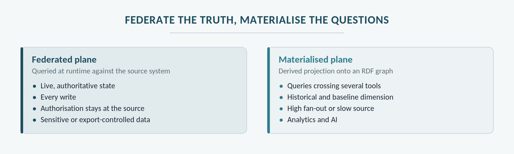

# Executive summary

*Version 1.0 · draft for review · product owner and approvers to be defined.*

This document defines an **accelerator for engineering data integration projects**: a set of software components, reference models and method that connects a programme's tools — PLM, requirements, MBSE, calculation, test, plant, documents — into a governed digital thread, in weeks rather than months, without replacing any tool.

**The problem.** In complex programmes, traceability between requirements, architecture, product, calculations and tests is held together by spreadsheets and people. Every question that crosses two tools — what does this change touch, is this component covered by tests, what was the state at the design review — costs hours or days, and the answer cannot be reproduced. Point-to-point integrations grow as N×N and break at every upgrade.

**The intent.** The platform does three things, and only three: it **connects** tools without copying their data, it **remembers** the state of relationships over time, and it **enforces** authority, maturity and configuration rules deterministically. The principle that holds them together is **federate the truth, materialise the questions**: data stays in its authoritative system and is read live; only recurring questions that cross several tools are materialised in a derived graph, rebuildable and never authoritative.

**How it works.** Standard adapters — OSLC, API, MCP, file extraction — expose each tool's artefacts with a stable identity. An integration bus propagates changes as events. A federated plane lets people create and navigate links inside their working tools; a materialised plane — RDF graph, Terminology Service, lakehouse — answers cross-cutting questions: impact, coverage, maturity coherence, state at a past baseline. An orchestrator ties everything to the product lifecycle: change originates as a Change in the PLM backbone, and specialist tool results are published and, after review, promoted to governed records.

**Why an accelerator.** Every programme has different tools, versions and rules, but integration problems repeat: identity, links, configuration, maturity, units of measure, audit evidence. The accelerator brings ready-made what repeats — runtime, adapter catalogue, reference models, governance kit, method — and leaves the project only what is genuinely specific: type mappings, programme rules, adapters for tools not yet covered. The goal is to bring the integration cost of a tool below twenty person-days and to deliver the first governed thread within phase 1.

**Non-negotiable principles.** The source system stays authoritative; every projection is rebuildable; identity is opaque and stable; every assertion carries provenance; authority is declared across five dimensions — object, attribute, relationship, lifecycle, baseline; published does not mean released. Artificial intelligence enters after the foundation, read-only, and its proposals never become evidence without human confirmation.

**Deployment.** Every component ships as a container, with the same images in the cloud or on-premise, including isolated installations for export-controlled contexts.

**Path.** Adoption proceeds in seven phases, from mobilising governance to AI-enabled engineering, and each phase delivers usable value on its own. Advance when ownership, quality and user outcomes are demonstrated, not when a platform is installed.

**Audience.** Systems and product engineers, quality and compliance leads, technical project managers, configuration managers, and the delivery team that installs, configures and puts the accelerator into operation at each programme.

**Non-goals.** The platform does not replace authoring tools, does not become the system of record for any product data, does not run calculations, does not manage CAD geometry and does not govern the Change: it feeds it and makes it observable.
