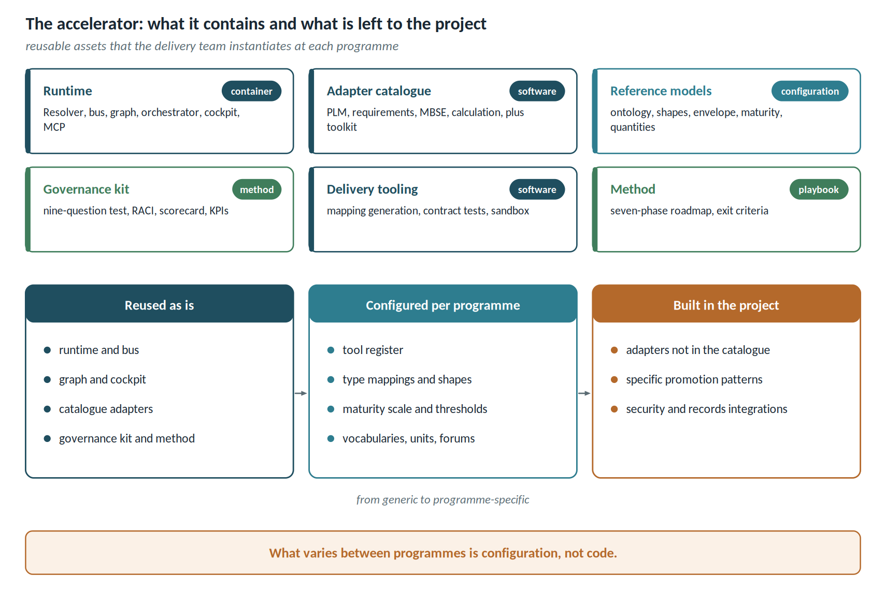

# The accelerator: composition and engagement model

The accelerator is neither a product to install and forget nor a project to redo every time. It is a set of reusable assets that a delivery team instantiates at a programme, configures to its rules and completes with what is missing.

## What it contains

| Component | Content | Nature |
| ------ | ------------------------------------------ | ----------- |
| Runtime | Resolver, integration bus, federated plane, graph, Terminology Service, orchestrator, cockpit, MCP server | software, shipped as containers |
| Adapter catalogue | adapters for the most common PLM, requirements, MBSE and calculation platforms, plus the toolkit to write new ones and the publication kit for desktop tools | software and templates |
| Reference models | minimal ontology, SHACL shapes, publication envelope, canonical maturity scale, quantity dictionary | versioned configuration |
| Governance kit | nine-question authority test, forums and RACI, onboarding scorecard, KPI catalogue | method and templates |
| Delivery tooling | assisted mapping and shape generation, contract tests, sandbox environments | software for the delivery team |
| Method | seven-phase roadmap, exit criteria, adoption model | playbook |

## Reused, configured, built

| Reused as is | Configured per programme | Built in the project |
| ------------- | --------------------------- | -------------------- |
| runtime, bus, graph, cockpit, MCP server | tool register, type mappings, programme shapes, maturity scale, thresholds, roles | adapters for tools not in the catalogue |
| catalogue adapters | domain vocabularies and taxonomies, permitted units | promotion patterns specific to the customer's PLM backbone |
| governance kit and method | forums, RACI and KPIs adapted to the organisation | integrations with the customer's records and security services |

The design rule is that **everything that varies between programmes is configuration, not code**: state names, taxonomies, units, maturity rules, forums. A programme that requires changing the runtime signals a limit of the reference model, and that limit is fixed in the accelerator, not in the single project.

## Engagement model

1. **Assessment** — census of tools, flows and recurring questions; measurement of objective baselines; application of the onboarding scorecard.
2. **Foundation** — container installation, identity strategy, tool register, first adapters on the PLM backbone and requirements.
3. **First governed thread** — a complete requirement-to-product path on a pilot project, with measured exit criteria.
4. **Onboarding waves** — tools added by priority, with the integration factory and contract tests.
5. **Transfer** — the programme runs the platform with its own forums and team; the accelerator stays upgradable.

The detailed phases are described in the adoption roadmap.
