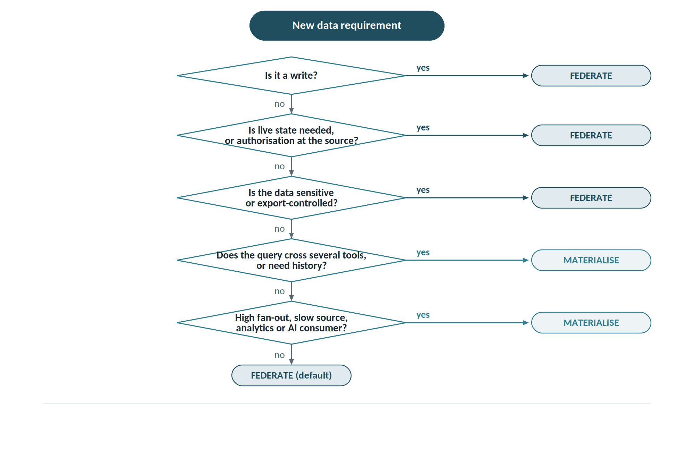

# Architectural principles

Eight principles constrain every downstream decision. They are listed in precedence order: where they conflict, the higher one wins.

1. **The source system stays authoritative.** The graph is a derived projection. Data that does not exist in a tool is never written into the graph.
2. **Total rebuildability.** The graph must be deletable and fully reconstructable by replaying change logs and preserved packages. If it is not, a second master has been created.
3. **Identity first.** Every artefact has a stable, opaque, resolvable URI, never derived from a mutable path.
4. **Provenance on every assertion.** Which adapter, which event, which timestamp, which user.
5. **No domain logic in the ESB.** The ESB mediates protocols and security. Semantics belong in adapters and in the model; the Change and promotion orchestrator executes versioned, approved rules, not hard-wired logic.
6. **Adoption before completeness.** Three tools that work well beat twenty adapters nobody uses.
7. **Explicit authority across five dimensions.** For every shared object, declare who holds authority over object, attribute, relationship, lifecycle and baseline for every shared object.
8. **Published does not mean released.** Authority changes only through the destination system's lifecycle.

## Decision rule: federate or materialise

| Criterion | Federate (query time) | Materialise (graph) |
| ---------------------------------- | ------------------ | ------------------ |
| Live state required | yes | no |
| A write is involved | yes | never |
| Authorisation must stay at the source | yes | no |
| Sensitive or export-controlled data | yes | no |
| Query crosses several tools | no | yes |
| Historical or baseline dimension needed | no | yes |
| High fan-out or slow source | no | yes |
| Consumer is analytics or AI | no | yes |

In practice: pointwise link navigation and every write operation go through federation; matrices, coverage reports, impact analysis and dashboards read from the graph.
