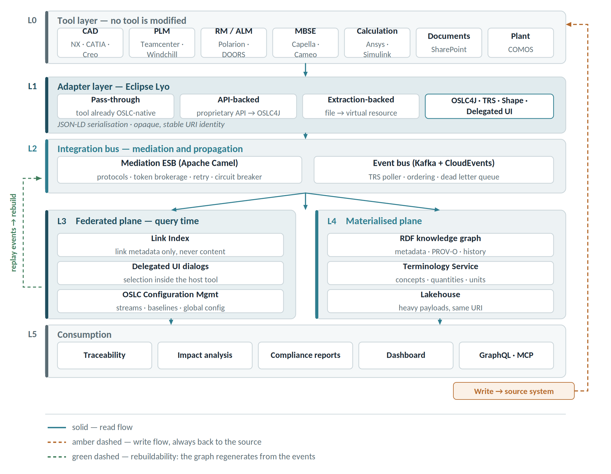
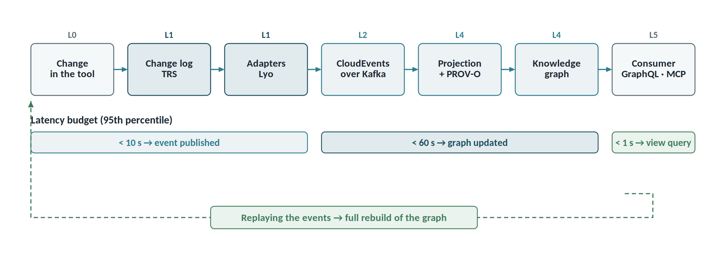
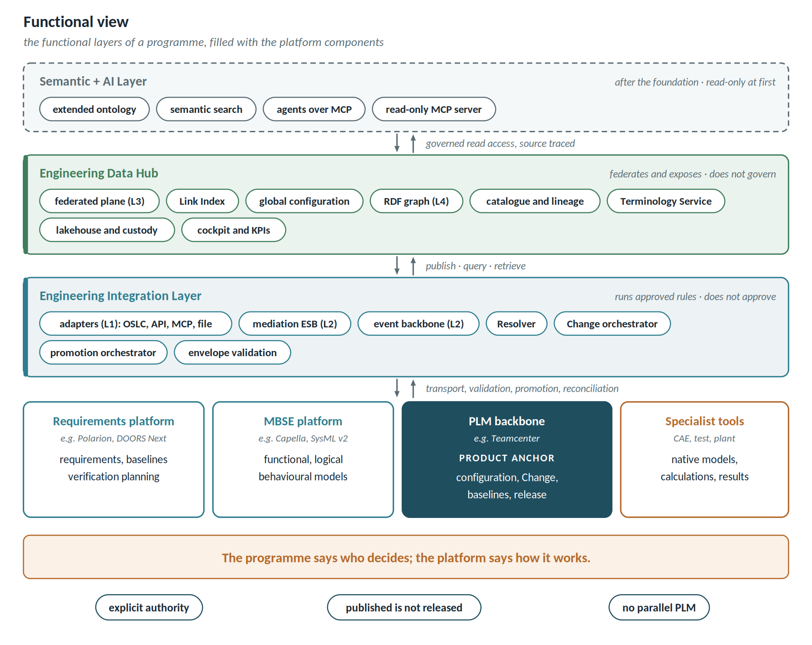

# Reference architecture

Six planes, from tool to consumption. The read flow moves left to right; the write flow always travels back to the source system.

**L0 — Tool layer.** No tool is modified. In scope: CAD (NX, CATIA, Creo), PLM (Teamcenter, Windchill), RM/ALM (Polarion, DOORS Next), MBSE (Capella, Cameo), calculation (Ansys, Simulink, controlled spreadsheets), documents (SharePoint, Documentum), plant (COMOS). Where the programme designates a PLM backbone, it plays a role distinct from the others: it is the product, configuration and Change anchor (see the functional view and the data governance model).

**L1 — Adapter layer (Eclipse Lyo).** Three patterns, chosen by what the tool exposes. A fourth, MCP-backed, is described in the section on architecture in the age of agents and is the first choice wherever the vendor exposes an MCP server. A fourth, MCP-backed, is described in the section on architecture in the age of agents and is the first choice wherever the vendor exposes an MCP server.

| Pattern | When | Example | Lyo component |
| ---------------- | -------------------- | -------------------------- | ---------------- |
| Pass-through | tool is already OSLC-native | Polarion, DOORS Next | Lyo Client |
| API-backed | proprietary API available | Teamcenter SOA, Windchill, Capella EMF | OSLC4J server |
| Extraction-backed | files only | spreadsheets, FEM results, documents | OSLC4J + Lyo Store |

Components used: **OSLC4J** for servers, **Lyo Designer** to generate scaffolding, **Lyo Store** for local persistence, **Lyo Validation** (SHACL) for contracts, and **TRS** as the change propagation mechanism.

**L2 — Integration bus.** Two distinct responsibilities, often conflated.

- *Mediation ESB* (Apache Camel): translates protocols (SOAP, COM, file, REST → OSLC), performs OAuth2/OIDC token brokerage with user identity delegation, applies throttling and circuit breakers against fragile APIs, guarantees idempotency and retry, and logs every cross-tool call.
- *Event bus* (Kafka): a TRS poller reads adapter change logs and publishes events per resource type. This is the spine that feeds the materialised plane.

**L3 — Federated plane.**

- *Link Index*: an index of links only (source URI, target URI, type, provenance, author, configuration context). Never content.
- *Delegated UI dialogs* (OSLC): selection and preview of a remote resource from inside the working tool.
- *OSLC Configuration Management*: global configurations, streams and baselines. Without configuration context, links are ambiguous wherever variants exist.

**L4 — Materialised plane.**

- *RDF knowledge graph* (GraphDB, Stardog or Neptune) fed by TRS events. Holds metadata: types, attributes, relationships, versions. Never CAD geometry or document bodies.
- *Terminology Service*: the registry of concepts, quantities and units, and of native-term to canonical-concept mappings. It is the single authority on meaning; adapters, graph and consoles query it rather than duplicating it.
- *Lakehouse / object store* for heavy payloads, indexed by the same URI. Iceberg or Delta for tabular data.
- *Semantic layer*: OSLC core vocabularies (RM, QM, CM, AM) plus a domain ontology, aligned with ISO 15926/CFIHOS on the plant side and the PLM data model on the product side. SHACL as a verifiable contract.
- *Historisation*: events are append-only, but reconstructing a past baseline is not free: it needs events pinned to immutable versions, log retention, and preserved packages where the tool keeps no versions (FR-G10).

**L5 — Consumption.** Traceability and coverage matrices, impact analysis, compliance reports, dashboards, document generation from the graph, and a read-only MCP server for agents.

## Functional view

| Functional layer | Platform components | Responsibility |
| ------------ | -------------------------- | ---------------------- |
| PLM backbone (e.g. Teamcenter) | tool acting as the product anchor | product, configuration, Change, baselines, release, released evidence |
| Requirements platform (e.g. Polarion) | OSLC pass-through adapter | requirement content and baselines, verification planning |
| MBSE platform (e.g. Capella, SysML v2) | API or SysML v2 API adapter | operational, functional, logical and behavioural models |
| Specialist tools | extraction or MCP adapter, intentional publication | native models, calculations, raw results |
| Integration layer | adapters (L1), integration bus (L2), Resolver, Change and promotion orchestrator | transport, validation, identity, promotion, reconciliation |
| Engineering data hub | federated plane (L3), graph and Terminology Service (L4), lakehouse, cockpit | catalogue, lineage, provenance, cross-domain views, custody |
| Semantic and AI layer | extended ontology, semantic search, agents over MCP | after the foundation, read-only at first |

The two views describe the same platform: the logical one by planes, the functional one by responsibilities. The graph is the data hub's store and acquires no lifecycle authority: it federates and exposes, it does not govern. That is the rule which stops the hub from becoming a parallel PLM.

## Cross-cutting components

- **Resolver** — keeps the correspondence between opaque URIs, native identifiers and deep links; handles aliases and tombstones.
- **Change and promotion orchestrator** — distributes a Change's work packages and executes pre-approved promotion patterns; applies versioned rules, not hard-wired logic.
- **Terminology Service** — ontology, taxonomies and quantity dictionary, with four-eyes approved mappings.
- **MCP server** — exposes the graph and the Terminology Service to agents, read-only at first.

## Deployment view

Every component ships as an **OCI container** orchestrated on Kubernetes. The same images run in public cloud, private or sovereign cloud, and on-premise: between environments only configuration changes. For export-controlled programmes an **isolated** installation is provided, with no dependency on external services and with AI components running inside the perimeter or switched off.

| Layer | Containers | Persistent state |
| ------ | ---------------------------------- | --------------------- |
| Integration | one container per adapter, mediation ESB, Resolver, orchestrator | configuration, identity map |
| Events | Kafka broker with schema registry | event log, with declared retention |
| Data hub | triple store, Terminology Service, GraphQL service, lakehouse | graph, vocabularies, preserved packages |
| Consumption | cockpit, consoles, MCP server | none |

| ID | Deployment requirement | Priority |
| --- | ------------------------------------------------------ | ---- |
| DR-01 | Ship every component as a versioned, signed OCI image | Must |
| DR-02 | Provide Helm charts with per-environment values and no code difference between cloud and on-premise | Must |
| DR-03 | Support isolated installations, with image registry and dependencies inside the perimeter | Must |
| DR-04 | Keep persistent state outside containers, with documented backup and restore for graph, event log and lakehouse | Must |
| DR-05 | Scale adapters independently of one another | Should |
| DR-06 | Integrate identity with the customer's provider (OIDC, SAML), with no local accounts | Must |
| DR-07 | Expose metrics, traces and logs as OpenTelemetry towards the customer's observability stack | Should |
| DR-08 | Allow AI components to be switched off or replaced with no impact on the rest of the platform | Must |
