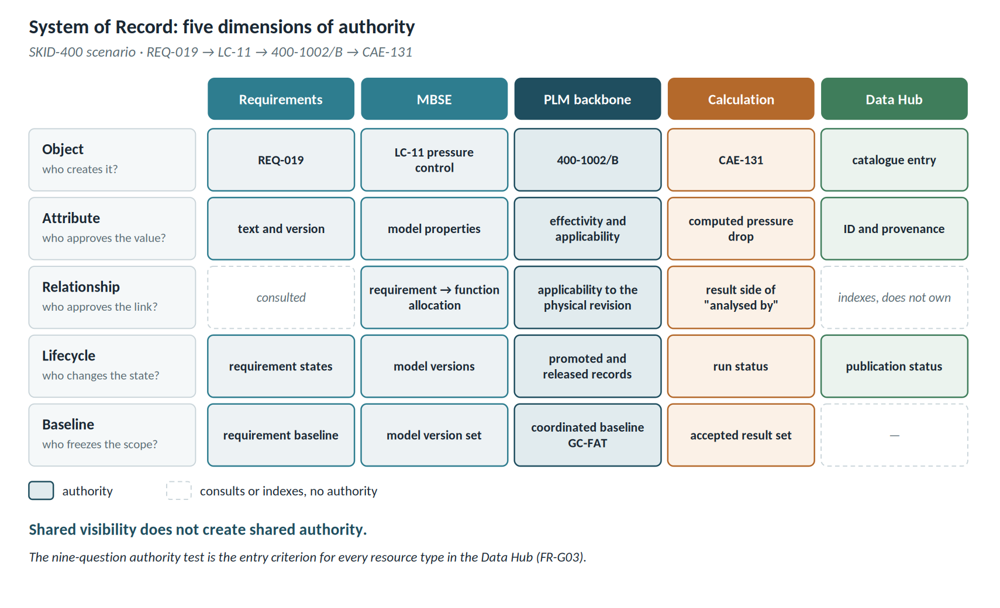
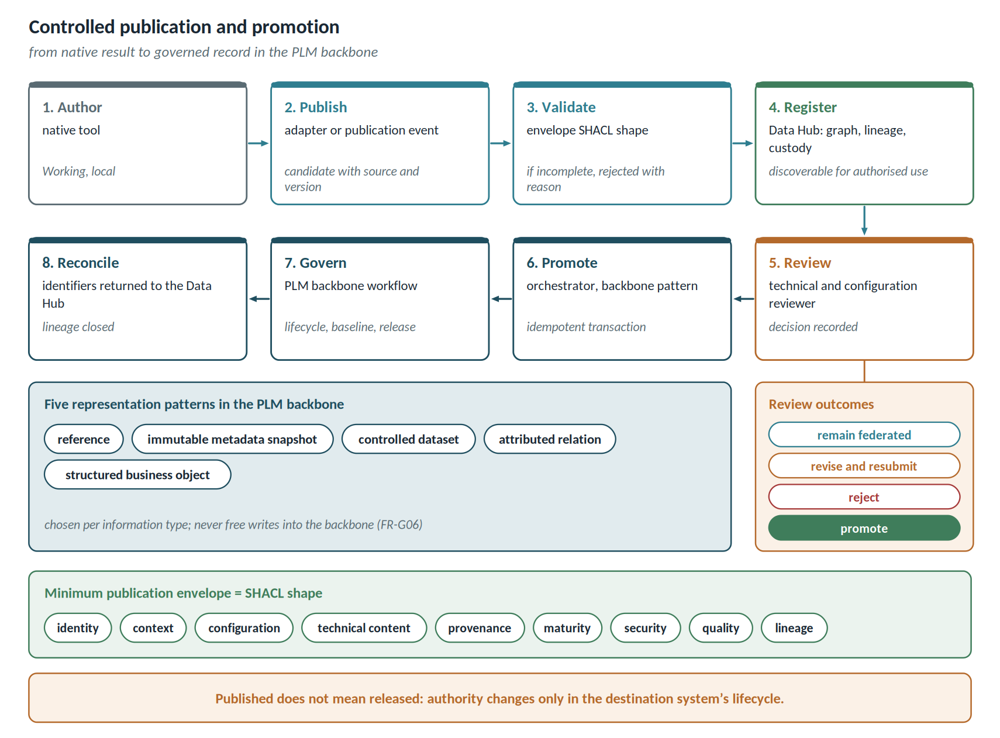
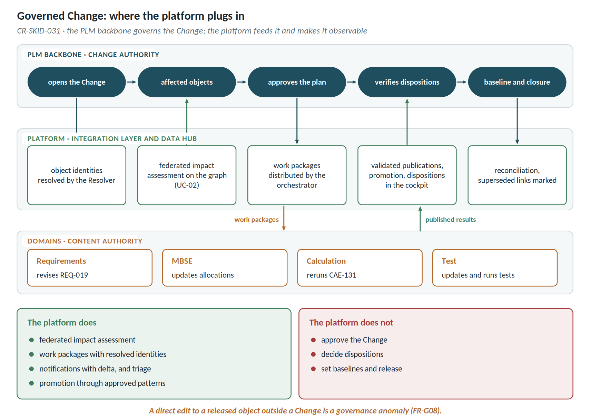
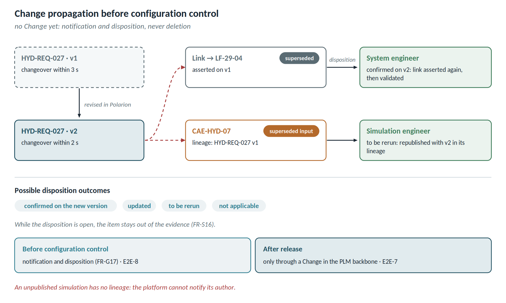

# Data governance model

Connecting tools is the easy part. The hard part is establishing who has the last word on each piece of data, when a result becomes shared, when it becomes official, and how proof of all this is preserved. This chapter defines the **data governance model** the platform enforces: it is what distinguishes a governed digital thread from a collection of links.

The model rests on a precedence rule: on authority, lifecycle and governance, the programme's systems of record and forums decide; on mechanisms and technology, the platform decides. **The programme says who decides; the platform says how it works.**

## System of Record: five dimensions of authority

Authority is not declared per tool but across five dimensions for every shared object. On the SKID-400 scenario:

| Dimension | Question | Example |
| ---------------- | ---------------------------------- | -------------------------------------------------- |
| Object | who creates and maintains the native object? | requirements own REQ-019, the backbone owns 400-1002/B |
| Attribute | who approves each shared value? | calculation owns the computed pressure drop, the backbone owns effectivity |
| Relationship | who creates, approves and retires the link? | MBSE governs the logical allocation, the backbone the applicability to the physical revision |
| Lifecycle | who changes maturity or release state? | each domain its own, the backbone the promoted records |
| Baseline | who freezes the scope? | each domain its own, the backbone the coordinated baseline |

A resource type enters the hub only if it passes the **nine-question authority test** (FR-G03):

1. Where is the information created?
2. Where can it be modified?
3. Which platform determines the approved value?
4. Which version or baseline applies?
5. Which systems only display or index it?
6. What happens if two systems disagree?
7. How is the authoritative source identified?
8. Does the information require promotion into the backbone?
9. Who approves a change of authority?

**Shared visibility does not create shared authority.**

## Publication and controlled promotion

**Publication** is the intentional sharing of a versioned representation. **Promotion** is the controlled creation of a governed representation in the PLM backbone. **Published does not mean released.**

| Step | Platform component | Outcome |
| ---------------- | ------------------------------------ | ------------------------------------ |
| 1. Author | native tool | working data, local to the domain |
| 2. Publish | adapter or publication event | candidate with source and version |
| 3. Validate | envelope SHACL shape | incomplete package rejected with a reason code |
| 4. Register | hub: graph, lineage, custody | publication discoverable for authorised use |
| 5. Review | technical and configuration reviewer | decision recorded |
| 6. Promote | orchestrator, pre-approved backbone pattern | idempotent transaction |
| 7. Govern | PLM backbone workflow | lifecycle, baseline, release |
| 8. Reconcile | identifiers returned to the hub | lineage closed |

The review has four outcomes: **remain federated**, **revise and resubmit**, **reject**, **promote**. Promotion uses only pre-approved representation patterns:

| Pattern | When |
| ------------------------------ | ------------------------------------------------------ |
| Reference | the source is durable and PLM custody is not required |
| Immutable metadata snapshot | decision context must be preserved while heavy data stays outside |
| Controlled dataset | the artefact is evidence, a deliverable or baseline content |
| Attributed relation | the relationship itself carries applicability, method or rationale |
| Structured business object | the result is managed as a first-class entity |

The minimum publication envelope — identity, context, configuration, technical content, provenance, maturity, security, quality, lineage — is the SHACL shape of the publication.

Promotion is the only path, other than links, by which the platform writes into a source system. The orchestrator invokes pre-approved patterns only, retries are idempotent, and no released evidence is ever overwritten.

## Two ingestion modes

| Mode | For which systems | What enters the hub |
| ---------------------- | ---------------------------------- | ---------------------------------------- |
| Continuous projection | already governed platforms: PLM backbone, requirements, MBSE | objects with their native state, drafts included and marked as such |
| Intentional publication | specialist tools | only published packages with a valid envelope; working data stays local |

Continuous projection serves traceability between already governed objects, and it is what makes maturity misalignments detectable. Intentional publication serves calculation and test results, where working data must not circulate.

## Desktop tools and local calculation

Tools such as MATLAB, Simulink, OpenModelica or a calculation spreadsheet have no server to query and no change log: they cannot be followed by continuous projection. They enter the platform by **intentional publication**: the engineer works locally and, when a result is ready to be shared, publishes it with its envelope. Work in progress stays local by design.

The pattern is the same for every tool:

1. **Inputs are read from the platform**, with their version: requirements, parameters and product data are never retyped. This is the condition for detecting a superseded input (FR-G19).
2. **Model and parameters live in a versioned repository** — git, PDM or a controlled library — and the publication cites their immutable reference (FR-G21). A file on a desktop has no identity and cannot be reproduced.
3. **A package is published** — result, envelope and lineage — which the platform validates with the SHACL shape (FR-G04), registers with a URI and projects into the graph.

The accelerator provides a single **publication kit** (FR-G18): a CLI with libraries for Python, MATLAB and Excel that always performs the same three steps. For Simulink the parameter version comes from the data dictionary; for OpenModelica, scripts or OMPython are used; to exchange models and parameters between different tools, FMI and SSP are preferred (FR-G22).

The spreadsheet is the most delicate case: it can be published only when built on a **controlled template**, with defined names for inputs and outputs, declared units and an envelope sheet (FR-G20). A free-form sheet is rejected with a reason code: the platform does not guess where the inputs are.

## Governed Change

A product-affecting change originates as a Change in the PLM backbone. **The platform does not govern the Change: it feeds it and makes it observable.**

| Change step | Platform contribution |
| ---------------------------------- | ---------------------------------------------------- |
| Opening and affected objects | object identities resolved by the Resolver |
| Federated impact assessment | impact analysis on the graph (UC-02), with out-of-date nodes declared |
| Distribution of work packages | orchestrator, towards the domain owners |
| Execution in the domains | notifications with delta and triage (UC-08, UC-20) |
| Publication of results | envelope validation, registration, lineage |
| Promotion and verification of dispositions | backbone patterns, open dispositions in the cockpit |
| Closure | reconciliation and superseded links marked; closure stays with the backbone |

A direct edit to a released object, outside a Change, is reported as a governance anomaly (FR-G08).

## Before configuration control

The Change governs what is under configuration control. In the early phases, when requirements, models and simulations evolve before any released design exists in the PLM backbone, there is no Change yet, but a change must still not go unnoticed. The platform then applies a lighter regime, **notification and disposition**:

- every asserted link and every published result records the version of its inputs;
- a new version of an input makes dependent links superseded and marks results as *superseded input*, without deleting them;
- the owner of each superseded item receives a disposition to close: confirmed on the new version, updated, to be rerun, not applicable;
- while the disposition is open, the item stays out of the evidence.

The switch between regimes is automatic: once an object enters configuration control, its changes go through the Change (FR-G17). The platform only sees what is published: a simulation kept local has no lineage, and its author cannot be notified.

## Compliance evidence

The evidence of record is what the product system of record, or an approved repository, has released. The graph assembles, checks completeness and cites; aggregate indicators are derived, carrying source, calculation rule and freshness, and do not constitute a master status. UC-10 and FR-AG11 are to be read in that sense.

## Data custody

| Custody pattern | Where in the platform | Note |
| -------------------------- | ---------------------------------- | ---------------------------------- |
| Index only | graph: metadata, identity, lineage, URI | default |
| Index plus cache | lakehouse, regenerable copy | non-authoritative |
| Index plus preserved package | immutable lakehouse, with a retention policy | historical reconstruction where the tool keeps no versions |
| Reference to external repository | link to an approved records service | external custody |
| Promoted representation | lineage towards the PLM backbone | the backbone owns the lifecycle |

The word *archive* is used only where an approved records-management authority and retention policy exist.

**Historical reconstruction.** Rebuilding the state at a past baseline requires three conditions: events pinned to immutable version URIs, retention of the event log for the programme's full duration, and preserved packages where the tool keeps no versions (FR-G10). Without these three conditions a replay returns today's state, not the state as it was.
