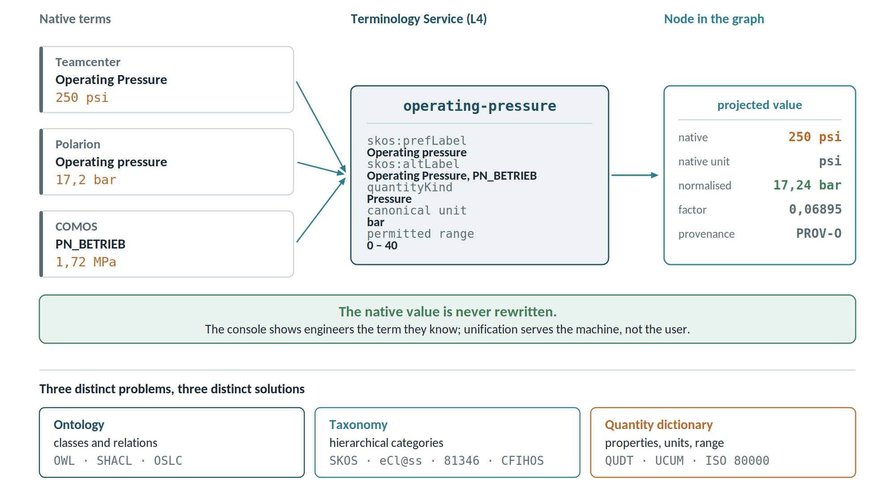

# Dictionary, taxonomy and quantities

Every tool names the same things differently, and the unification must happen at **one declared point**. In this architecture that point is the **Terminology Service** in L4: adapters translate towards it, never to each other.

## Three distinct things, often conflated

| Level | What it defines | Reference standards | Example |
| ---------------- | -------------------------- | -------------------------- | -------------------------- |
| Ontology | classes and relations between types | OWL, SHACL, OSLC vocabularies | "a requirement is verified by a test case" |
| Taxonomy | hierarchical categories of objects | SKOS, eCl@ss, ISO/IEC 81346, CFIHOS | "ball valve" under "valve" under "equipment" |
| Quantity dictionary | properties, quantity kind, unit, permitted values | QUDT, UCUM, ISO 80000 | "operating pressure: pressure, bar, 0-40" |

These are three problems with three different solutions. Treating them as one is the mistake that makes a vocabulary unmanageable after the third tool.

## What the Terminology Service holds

- A concept registry in **SKOS**: preferred label per language, synonyms, definition, deprecated concepts with their successor.
- **Quantity kinds and units** (QUDT or UCUM) with conversion factors, and the constraint that every quantity declares its unit.
- **Code lists** and their reconciliation across tools: statuses, criticality levels, material classes.
- The **native-term to canonical-concept map**, per tool, with provenance, author and confidence.
- The **domain classifications** adopted, each with its version.

## The rule: canonical at the centre, native preserved

The platform never rewrites source data. It keeps **both** — the value and unit as declared by the tool, plus the value normalised into the canonical unit — and the provenance of the conversion.

Two practical consequences. Verification stays possible: the original number can always be recovered. And the console shows the engineer **the term they know**, not the canonical one: unification serves the machine, not the user.

Unifying by destroying the original would break principle 2, rebuildability: replaying the events would no longer reproduce the same graph if a conversion factor had changed in the meantime.

## Requirements (FR-T)

| ID | Requirement | Priority |
| ---------- | -------------------------------------------------------- | ----------- |
| FR-T01 | Maintain a SKOS concept registry with labels, synonyms, definition and language | Must |
| FR-T02 | Maintain quantity kinds and units (QUDT/UCUM) with conversion factors | Must |
| FR-T03 | Maintain, per tool, the native-term to canonical-concept map with provenance and confidence | Must |
| FR-T04 | Always keep native value and unit alongside the normalised value | Must |
| FR-T05 | Reconcile code lists across tools; an unmapped value is flagged, never silently dropped | Must |
| FR-T06 | Version the vocabulary, with deprecated concepts pointing to their successor | Must |
| FR-T07 | Host the domain classifications adopted (eCl@ss, ISO/IEC 81346, CFIHOS, internal PLM classification) | Should |
| FR-T08 | Expose the vocabulary as a service queryable by adapters, graph and consoles | Must |
| FR-T09 | Flag the arrival of a new term or value with no canonical mapping | Must |
| FR-T10 | Reject projection of a quantity with no declared unit or an unrecognised unit | Should |

## Governance

The vocabulary needs a named owner — this is the open question already raised at the end of this document. Without a **terminology board** approving mappings, the ontology diverges within six months and the graph becomes useless for compliance reporting.

Unit and quantity mappings require four-eyes approval, like promotion to production. The reason is in the section that follows.

## Domain-specific content

- As-designed, as-built and as-flown BOM views, with serialised units.
- NCRs and anomalies linked to units, parts and lots.
- Declared lists of materials and processes linked to product revisions.
- Early-phase concurrent design parameters, still recreated by hand in many programmes: a direct case for the quantity dictionary.
- Domain taxonomies treated as configuration rather than code: ATA and S1000D in aviation, ECSS in space, KKS and RDS-PP in nuclear, DEXPI and CFIHOS in process plant.

Annexes D and E work two of these domains out in detail.
