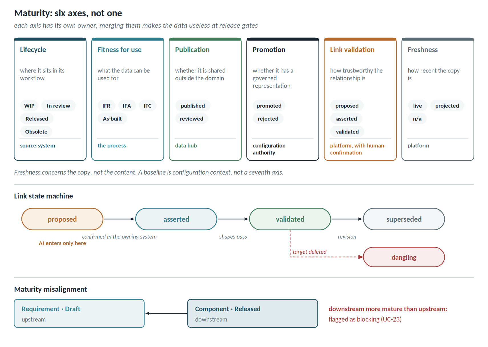
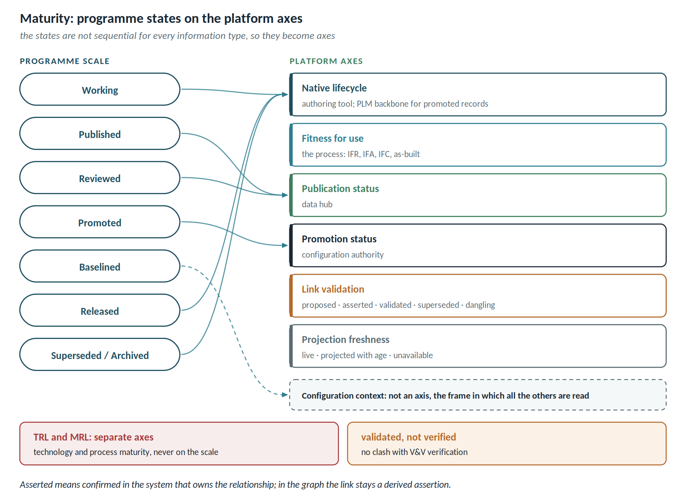

# Maturity and the state of exchanged data

The word "maturity" hides **six distinct concepts**. Merging them into a single field is the mistake that makes the data useless exactly where it is needed: at release gates.

## Six axes, not one

| Axis | What it says | Typical values | Owner |
| -------- | ------------------ | -------------------- | ------------- |
| Lifecycle state | where the data sits in its workflow | WIP, In review, Released, Obsolete | source system |
| Fitness for use | what the data can be used for | IFR, IFA, IFC, As-built | the process |
| Publication status | whether the data is shared outside its domain | not published, published, reviewed | data hub |
| Promotion status | whether the data has a governed representation | not promoted, promoted, rejected | configuration authority |
| Link validation | how trustworthy the relationship is | proposed, asserted, validated, superseded, dangling | platform, with human confirmation |
| Projection freshness | how recent the copy is | live, projected with age, unavailable | platform |

**Freshness concerns the copy, not the data.** An artefact can be Released, IFC, published, promoted and with validated links, and its projection still be four hours old: the cockpit always says so. Baseline membership is not a seventh axis but the configuration context in which all the others are read. TRL and MRL stay off the scale: they measure technology and manufacturing process, not data.

## Programme states on the axes

| Programme state | Where it is read in the platform | Who governs it |
| ----------- | ---------------------- | -------------------------- |
| Working | lifecycle axis, native state | authoring tool |
| Published | publication axis | data hub |
| Reviewed | publication axis, with disposition | technical reviewer |
| Promoted | promotion axis | configuration authority |
| Baselined | configuration context, not a maturity axis | domain; PLM backbone for the coordinated baseline |
| Released | lifecycle axis | PLM backbone or approved system |
| Superseded / archived | lifecycle axis and custody pattern | authorised archive |

These states are not sequential for every information type: that is why the platform spreads them across axes rather than one scale.

*Validated* denotes an asserted link that complies with the shapes: the term is chosen so as not to clash with V&V verification. *Asserted* means confirmed in the system that owns the relationship; in the graph the link remains a *derived assertion*, with its validation outcome.

## Maturity is relational, not scalar

The useful question is not "how mature is this dataset" but **"is it mature enough for that consumer to rely on"**. Geometry at 70% is perfectly fine for a layout study and entirely unfit for programming an NC machine.

A precise architectural consequence follows: **maturity is not an attribute of the node, it is a constraint on the link.** And a constraint on a link, in this platform, is a SHACL shape. For example:

- a Released component cannot trace to a Draft requirement;
- a verification result cannot claim coverage from a test case in WIP;
- an IFC item cannot derive from a P&ID still at IFR.

## Link state machine

The validation state originates in the platform, but it does not give the platform ownership of the relationship: the relationship stays with the system that owns it, and in the graph the link is a derived assertion with its outcome.

| State | Meaning | Who produces it |
| ---------------- | ---------------------------------------------- | -------------------- |
| proposed | suggested but not confirmed | AI or an automated rule |
| asserted | confirmed in the system that owns the relationship | engineer of the owning domain |
| validated | asserted and compliant with the maturity shapes | platform |
| superseded | source or target has been revised | platform |
| dangling | the target is obsolete or deleted | platform |

This makes FR-AI06 enforceable: a link suggested by AI enters as *proposed*, and only human approval moves it to *asserted*. The state machine is the mechanism that enforces the governance constraint, rather than leaving it to goodwill.

## The two highest-value use cases

**Misalignment detection.** The graph identifies cases where **the downstream artefact is more mature than its upstream source**: a component released against a requirement still in draft. It is a real red flag, and no single tool can see it — it needs exactly the cross-tool view this platform builds.

**Baseline coherence.** At a baseline, every artefact must sit at a declared minimum maturity. This becomes an automatically verifiable gate rather than a meeting.

## Requirements (FR-S)

| ID | Requirement | Priority |
| ---------- | -------------------------------------------------------- | ----------- |
| FR-S01 | Project each artefact's native lifecycle state, always preserving the original value | Must |
| FR-S02 | Hold, in the Terminology Service, the mapping from native states onto a canonical scale | Must |
| FR-S03 | Declare the ordering of the canonical scale explicitly, with four-eyes approval | Must |
| FR-S04 | Model fitness for use as a property distinct from lifecycle state | Should |
| FR-S05 | Assign every link a maturity state, with an explicit state machine | Must |
| FR-S06 | An AI-generated link enters as proposed and cannot become asserted without human approval | Must |
| FR-S07 | Mark as dangling any link whose target becomes obsolete or is deleted | Must |
| FR-S08 | Mark as superseded any link whose source or target has been revised | Should |
| FR-S09 | Express maturity constraints as SHACL shapes on links, with configurable severity | Must |
| FR-S10 | Detect and report misalignment: a downstream artefact more mature than its upstream source | Must |
| FR-S11 | Check a baseline's maturity coherence against a declared minimum threshold | Should |
| FR-S12 | Exclude not-yet-asserted links from compliance reports, stating their number explicitly | Must |
| FR-S13 | Record, for each asserted link and each published result, the version of every input artefact at the time of assertion or publication | Must |
| FR-S14 | On a new version of an input, mark dependent links as superseded and published results as "superseded input", without deleting them or blocking access | Must |
| FR-S15 | Open a disposition for the owner of each superseded item, with four outcomes — confirmed on the new version, updated, to be rerun, not applicable — configurable deadline and escalation; record outcome, author and rationale | Must |
| FR-S16 | Exclude from evidence and compliance reports the results with superseded input and the items with an open disposition, stating their number | Must |

## Who owns what

Lifecycle state is **derived, never written by the platform**: writing it would make the graph a second master and violate principle 1. Harmonising the native vocabularies is precisely FR-T05, code list reconciliation: the native state is preserved and the canonical one sits alongside it.

## Three traps

- **Cross-tool ordering is as dangerous as units.** Does Polarion's "Approved" sit above or below Teamcenter's "Released"? A wrong ordering lets gates pass silently: it is the same class of error as a psi to bar conversion — invisible and propagating. It goes to the terminology board, with four-eyes approval.
- **No numeric scores.** A 0-100 maturity score is not auditable and no engineer believes it. Use named ordinal states with a declared ordering.
- **Garbage in.** If everyone in a system leaves everything in WIP because the workflow is inconvenient, canonical maturity inherits the noise. Measure the distribution of native states **before** building gates on top of them.

## Prior art

There is no OSLC domain for maturity: it is modelled with properties and shapes. Useful references for the scale: the **ISO 19650 suitability codes** in the BIM world, which formalise fitness for use precisely; **ProSTEP/VDA maturity levels** in automotive; and the **EPC issue statuses** (IFR, IFA, IFC, As-built) already familiar on the plant side.
