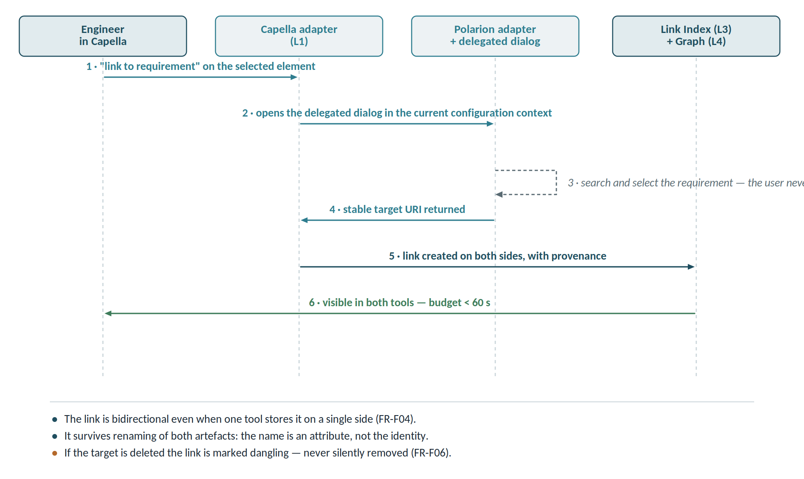

# Use cases

Thirty use cases, each with actor, architectural plane and priority. The most representative are followed by a detailed flow; concrete examples of all thirty are in Annex B.

| ID | Use case | Actor | Plane | Priority |
| --------- | ---------------------------------- | --------------- | ---------------- | --------- |
| UC-01 | Create a tracked link between artefacts in different tools | Engineer | Federated | Must |
| UC-02 | Upstream and downstream impact analysis | Systems engineer | Graph | Must |
| UC-03 | Generate a traceability and coverage matrix | Quality lead | Graph | Must |
| UC-04 | Navigate a link and open the artefact in its tool | Engineer | Federated | Must |
| UC-05 | Detect dangling or broken links | Administrator | Graph | Must |
| UC-06 | Reconstruct traceability at a past baseline | Auditor | Graph | Should |
| UC-07 | Verify completeness rules across the model | Quality lead | Graph | Should |
| UC-08 | Propagate change notifications to linked artefacts | Engineer | Events | Should |
| UC-09 | Link a calculation case to the configuration that produced it | CAE analyst | Federated+Graph | Should |
| UC-10 | Generate a compliance document from the graph | Quality lead | Graph | Should |
| UC-11 | Compare two baselines and produce the delta | Project manager | Graph | Could |
| UC-12 | Query the graph in natural language | All | Graph | Could |
| UC-13 | Consume the graph from a third-party application over GraphQL | Developer | Graph | Should |
| UC-14 | Feed the graph from a SysML v2 model through its standard API | Systems engineer | Graph | Should |
| UC-15 | Import a DEXPI P&ID and link equipment to architecture and requirements | Process engineer | Graph | Could |
| UC-16 | Correlate an in-service asset (AAS / OPC UA) with its as-designed configuration | Maintenance engineer | Federated+Graph | Could |
| UC-17 | Align a native term with the canonical concept | Data steward | Terminology | Must |
| UC-18 | Normalise a quantity expressed in different units across tools | Engineer | Terminology | Must |
| UC-19 | Draft an adapter and its mapping from a native schema | Integrator | Design-time | Should |
| UC-20 | Classify the significance of a change and route the notification | Engineer | Events | Should |
| UC-21 | Suggest missing links and detect cross-tool semantic duplicates | Systems engineer | Graph | Should |
| UC-22 | Diagnose an item stuck in the dead letter queue | Administrator | Operations | Could |
| UC-23 | Detect downstream artefacts more mature than their upstream source | Quality lead | Graph | Must |
| UC-24 | Check baseline maturity coherence before release | Project manager | Graph | Should |
| UC-25 | Photograph system state at a baseline and compare it with another | Project manager | Cockpit | Should |
| UC-26 | Read the tool relationship map and its maturity composition | Systems engineer | Cockpit | Should |
| UC-27 | Query several tools through an agent orchestrating their MCP servers | Everyone | Agents | Should |
| UC-28 | Materialise in the graph the recurring questions found in the agent's logs | Data architect | Agents + graph | Should |
| UC-29 | Propagate a change before configuration control, with mandatory disposition | Engineer | Events | Must |
| UC-30 | Publish a result from a desktop tool with inputs read from the platform | Engineer | Materialised | Must |

## UC-01 — Create a tracked link

**Actor:** systems engineer. **Precondition:** both tools have an active adapter and the user holds rights in both.

1. The engineer opens an architecture element in Capella.
2. Selects "link to requirement" from the adapter menu.
3. An OSLC delegated dialog opens and queries Polarion in the current configuration context.
4. The engineer selects the requirement; the link is created with a stable URI on both sides.
5. A TRS event propagates the new link to the Link Index and the graph.

**Acceptance criteria:** the link is bidirectional; it is visible in both tools within 60 seconds; it carries provenance (author, timestamp, configuration context); it survives renaming of both artefacts.

## UC-02 — Impact analysis

**Actor:** systems engineer. **Trigger:** a proposed requirement change.

1. The engineer selects the requirement and requests downstream impact at depth 3.
2. The graph returns reachable architecture, components, bills of material, test cases and documents.
3. The result distinguishes direct from transitive links and flags nodes with stale data.
4. The engineer exports the result or attaches it to the change request.

**Acceptance criteria:** response under 5 seconds on a 10-million-triple graph; every node navigable to its source tool; the result reports data age per node.

## UC-03 — Traceability matrix

**Actor:** quality lead. **Trigger:** a project milestone or an audit request.

1. Select the global configuration and the artefact types for each axis.
2. The platform generates the matrix with coverage percentages and empty cells highlighted.
3. Export to Excel or PDF with a timestamp and baseline identifier.

**Acceptance criteria:** the matrix is reproducible months later with identical results if the baseline is frozen; every cell is clickable; the export records the configuration and generation date.

## UC-09 — Calculation and configuration

This is the most underestimated use case and the one that makes the difference in regulated sectors. A calculation result without the exact identity of its input configuration is not evidence — it is a number. The calculation adapter must capture, at check-in time, the triple of model, parameters and solver version, and publish it as an OSLC resource linked to the analysis case.

## UC-13 — Consumption over GraphQL

**Actor:** developer of an internal application. **Trigger:** a need to show traceability data inside an existing portal.

1. The developer inspects the GraphQL schema, generated automatically from the SHACL shapes.
2. Composes a query requesting exactly the fields the view needs.
3. The facade translates it into SPARQL against the graph and applies the user's access control.
4. Receives typed JSON, without needing to know RDF.

**Acceptance criteria:** no SPARQL knowledge required; the schema stays aligned with the shapes at every release; a query requesting unauthorised fields fails explicitly rather than returning partial results.

**Why it matters.** This is the recommendation that lowers the barrier to entry most. OSLC and SPARQL stay in the engine; whoever builds on the platform sees only GraphQL.

## UC-14 — Native SysML v2 source

**Actor:** systems engineer. **Precondition:** the MBSE tool exposes the SysML v2 API & Services.

1. The platform connects to the SysML v2 API instead of a generic OSLC adapter.
2. Reads the model with its native semantics — parts, ports, connections, requirements.
3. Maps the elements onto the ontology and projects them into the graph, preserving native identifiers.
4. Exposes the same elements as OSLC resources to the link layer.

**Acceptance criteria:** no semantic loss relative to the source model; SysML v2 identifiers remain resolvable; an OSLC link to a requirement works exactly as for any other tool.

**Why it matters.** A generic OSLC adapter over an MBSE tool flattens the model. With the native API the semantics arrive intact, and OSLC does only what it does best: the link.
