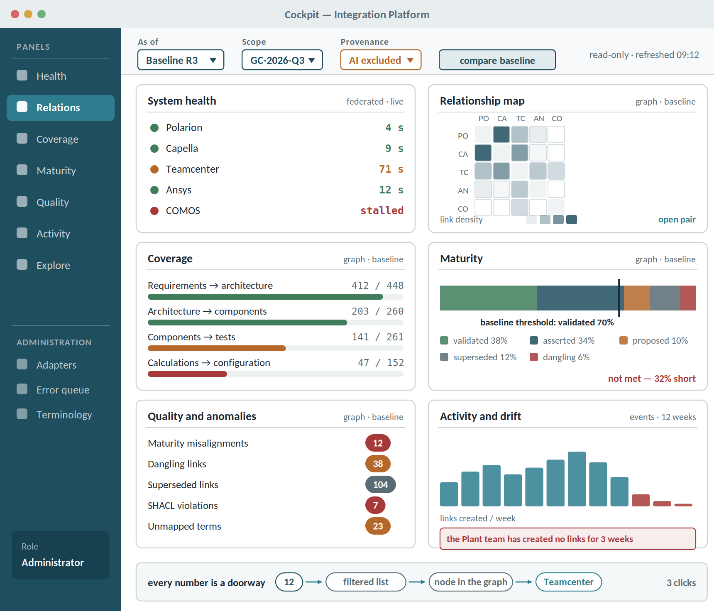

# Cockpit — a unified view of the exchanged data

The cockpit is **not a fifth console**: it is the usage console and the administration console fused around two global selectors. Almost every panel reads data already specified elsewhere in this document; what the cockpit adds is the **time axis** and the **system-level view**.

## Two selectors govern every panel

- **As of** — live, a baseline, or a date. In baseline mode the cockpit is read-only and **reproducible**: same inputs, same result six months later.
- **Scope** — global configuration, project, or set of tools.
- **Provenance** — include or exclude AI-generated items (FR-AI15) and not-yet-asserted links (FR-S12).

This is the photograph: not a real-time dashboard, but the **state of the system at a declared instant**. It is possible only because events are append-only. The cockpit is, literally, the return on the investment in principle 2.

## Seven panels

| Panel | Question it answers | Plane | Primary user |
| -------------------- | -------------------------------------- | -------------------- | -------------------- |
| System health | are the adapters propagating? | federated + events | administrator |
| Relationship map | which tools are linked to which, with how many links and of what type | graph | everyone |
| Coverage | how much traceability exists against what was expected | graph | quality lead |
| Maturity | how artefacts distribute across the canonical scale | graph | project manager |
| Quality and anomalies | dangling and superseded links, misalignments, SHACL violations, unmapped terms | graph | quality and administrator |
| Activity and drift | who creates links, where the flow has stopped | events | project manager |
| Exploration | from the number to the list to the node to the native tool | federated + graph | everyone |

## The relationship map is the panel missing today

The graph view already specified (UI-U01) **walks the nodes**: it starts from an artefact and expands. The opposite, system-level view is also needed: a tool-by-tool matrix with link volume, types and maturity composition.

It is the only view that answers **"what does our integration actually look like"** — and the answer usually surprises: two tools believed to be connected are not, and a large share of the links sits on a single pair.

## Interaction law: every number is a doorway

No metric without drill-down. Three clicks from the aggregate value to the artefact open in its native tool. **A number that cannot be opened should not be shown**: that is the rule separating a cockpit from a poster.

## Requirements (UI-K)

| ID | Requirement | Priority |
| ---------- | -------------------------------------------------------- | ----------- |
| UI-K01 | Global "as of" selector — live, baseline or date — persistent in session and visible on every panel | Must |
| UI-K02 | Global scope selector: global configuration, project, set of tools | Must |
| UI-K03 | Provenance filter: include or exclude AI-generated items and not-yet-asserted links | Must |
| UI-K04 | In baseline mode the cockpit is read-only and reproducible over time | Must |
| UI-K05 | Every panel declares its freshness and whether the data comes from the federated plane or the graph | Must |
| UI-K06 | Every aggregate value is openable: from the number to the list of items behind it | Must |
| UI-K07 | From any listed item, the artefact opens in its native tool in one click | Must |
| UI-K08 | No percentage without its denominator shown beside it | Must |
| UI-K09 | Health panel: status per adapter, propagation lag, error rate | Must |
| UI-K10 | Relationship map panel: tool-by-tool matrix with volume, link type and maturity composition | Must |
| UI-K11 | Coverage panel: coverage per artefact type against the expected completeness rule | Must |
| UI-K12 | Maturity panel: distribution across the canonical scale and baseline threshold check (UC-24) | Should |
| UI-K13 | Quality panel: dangling and superseded links, misalignments (UC-23), SHACL violations, unmapped terms | Must |
| UI-K14 | Activity panel: event volume over time, link creation per team, detection of stalled flows | Should |
| UI-K15 | Comparison between two instants or two baselines, with the delta per panel | Should |
| UI-K16 | Export of the state as a snapshot, carrying scope, instant and the queries used | Should |
| UI-K17 | Panel layout configurable per role, with a default landing panel | Could |
| UI-K18 | Operational actions are offered in the cockpit only to authorised roles and defer to the commands already specified in AR-02, AR-04 and AR-05 | Should |
| UI-K19 | Explicit refresh with a last-updated timestamp; no auto-refresh under one minute | Should |
| UI-K20 | Traffic-light thresholds configurable and attributed to a named owner | Must |

## Same cockpit, different roles

Not two applications. **Same numbers, different actions**: the administrator sees exactly the values the engineer sees, plus the operational commands. A separate administration cockpit would produce two truths, and the discussion would shift from "what do we do" to "which screen is right".

## What the cockpit does not do

- **It does not write to source systems.** Every corrective action opens the native tool: principle 1 applies here as everywhere.
- **It does not refresh in real time.** It is a photograph with a declared timestamp and explicit refresh. Continuous updating costs money, creates anxiety and changes no decision.
- **It shows no vanity metrics.** Total link count only ever goes up and says nothing. Show ratios with denominators, never bare counters.
- **It uses no traffic lights without declared thresholds and an owner.** A red nobody answers for is ignored within two weeks.
