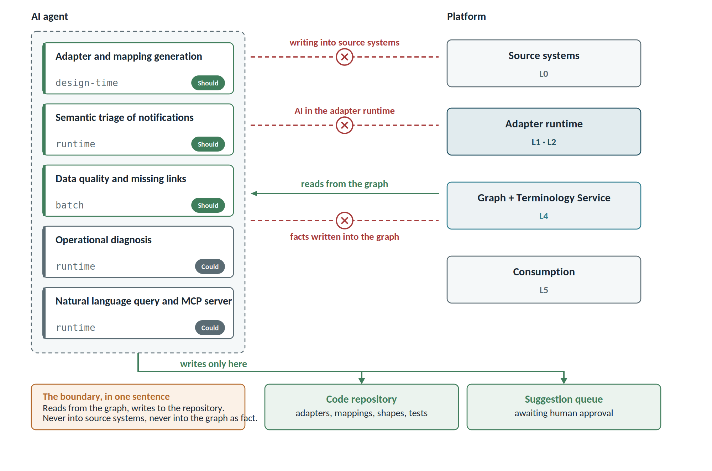

# Artificial intelligence in the platform

A single principle governs everything else: **AI reads from the graph and writes to the code repository. It never writes to source systems, nor to the graph as established fact.**

It follows that AI is not a new architectural plane: it is a consumer of L4 and an accelerator at design time. It appears on no critical path.

## Where AI pays off, in order of value

| Area | What it does | Timing | Priority |
| ------------------------ | ---------------------------------------- | -------------- | ---------- |
| Adapter and mapping generation | proposes domain model, OSLC mapping, shapes and tests from a native schema | design time | Should |
| Semantic triage of notifications | classifies the significance of a diff and routes accordingly | runtime | Should |
| Data quality and missing links | suggests links, detects semantic duplicates, analyses requirements | batch | Should |
| Operational diagnosis | proposes the cause of a dead letter queue error, detects audit log anomalies | runtime | Could |
| Natural language querying and MCP | translates a question into a query, read-only | runtime | Could |

The order is deliberate and counter-intuitive. **The MCP server is the most visible function but not the most useful**: it demos beautifully and gets little use. The real economic lever is the first row, because it is what defends the target of under 20 person-days per new tool.

## The two areas that actually move the numbers

**Adapter and mapping generation.** Lyo Designer already generates code from a model; AI does the step before, which today is entirely manual: from the native schema (OpenAPI, WSDL, EMF metamodel, PLM data model) to a proposed domain model and mapping. It also generates SHACL shapes from a real sample and contract tests from the shapes — the ones that mitigate the risk of a tool upgrade breaking an adapter. The output is code in a repository, reviewed by a person before merge.

**Notification triage.** UC-08 almost always fails through saturation: today every event counts the same and engineers mute everything within two weeks. A model can distinguish a typo fix in a description from a tolerance changing from 80 to 95 degrees Celsius, and route accordingly. That is the difference between a system that gets read and one that gets ignored.

## Requirements (FR-AI)

| ID | Requirement | Priority |
| ---------- | -------------------------------------------------------- | ----------- |
| FR-AI01 | Propose a domain model and OSLC mapping from a native schema, as an artefact to review and commit | Should |
| FR-AI02 | Generate SHACL shapes from a sample of real resources | Should |
| FR-AI03 | Generate contract tests from the shapes | Should |
| FR-AI04 | Classify the semantic significance of a diff and route the notification accordingly | Should |
| FR-AI05 | Draft the notification in natural language, with the explicit delta and a link to the artefact | Should |
| FR-AI06 | Suggest missing links with a score and supporting evidence, never creating them | Must |
| FR-AI07 | Detect cross-tool semantic duplicates and propose reconciliation | Should |
| FR-AI08 | Analyse requirement quality (ambiguity, passive voice, non-verifiability) against configurable rules | Could |
| FR-AI09 | Propose a diagnosis for dead letter queue items, from payload, error and logs | Could |
| FR-AI10 | Detect audit log anomalies: bulk link deletions, abnormal volumes, usage drift | Could |
| FR-AI11 | Translate a natural language question into SPARQL or GraphQL, show the query, run it read-only and cite node URIs | Could |
| FR-AI12 | Expose the platform's capabilities as an MCP server, under the same access controls as the user — promoted to Must with the adoption of an agent model, read-only in the initial phases | Must |
| FR-AI13 | Propose alignments between native terms and canonical concepts, and detect unit inconsistencies from value distributions | Should |
| FR-AI14 | Record every AI output with agent, model, version, evidence and confidence, through PROV-O | Must |
| FR-AI15 | Allow everything AI-generated to be excluded wholesale from compliance reports | Must |
| FR-AI16 | Respect data classification: no restricted or export-controlled content sent to a model outside the authorised perimeter | Must |

## Governance constraints

- **Never create links autonomously.** In a regulated context a wrong traceability link is worse than a missing one: it produces false evidence of compliance. AI suggests, a person approves.
- **Never put AI in the adapter runtime.** Non-determinism would destroy the rebuildability of the graph. If replaying events does not produce the same graph, principle 2 is lost and with it audit defensibility.
- **Separate, filterable provenance.** AI-generated items carry a distinct PROV-O class and must be excludable wholesale: it must be demonstrable that audit evidence was never touched by a model.
- **Confidence always visible.** Every suggestion shows its score and the evidence behind it. Below the configured threshold it is not offered at all.
- **Data perimeter.** The classification decided in the security section applies here too: where data cannot leave, either a model hosted inside the perimeter is used, or no AI is used on that perimeter.

## The most dangerous error

This deserves isolating because it does not resemble the others. **A wrong unit or quantity mapping is the worst class of error in the system**: it is invisible, it propagates everywhere, and nobody notices until someone sizes a component wrongly. A wrong link you can see; a wrong conversion you cannot.

For this reason AI proposals for terminology alignment (FR-AI13) always go to four-eyes approval by the terminology board, and are never applied automatically — not even at high confidence.
