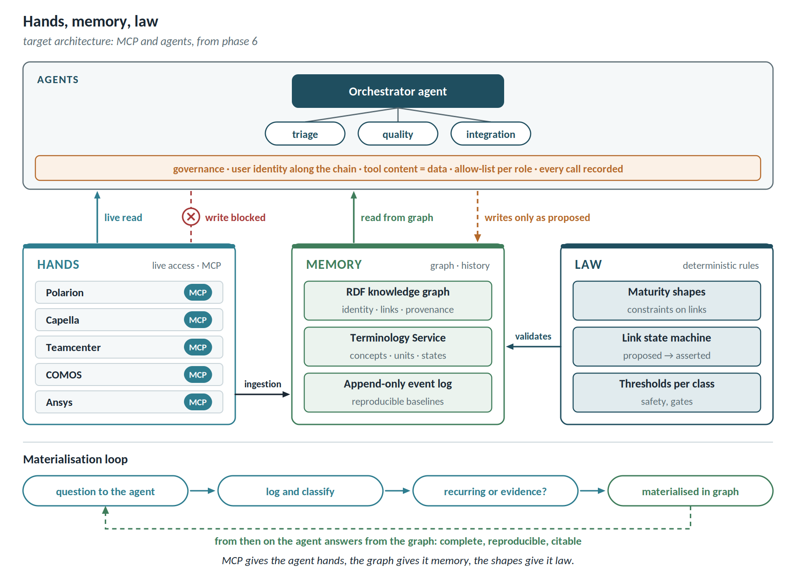

# Agents, MCP and orchestration

The platform is designed for a context in which every tool exposes its own MCP server and one or more agents orchestrate the information. In that context data access becomes a commodity, and value concentrates in what access does not provide: identity, asserted links, configuration context, history, and rules applied deterministically.

Agents enter the roadmap after the foundation, read-only. This chapter describes the target architecture and the rules that make it safe.

## The architecture decomposed by function

| Function | With MCP + agents | Outcome |
| -------------------------- | -------------------------------------------------- | -------------------- |
| Access to tool data | MCP does it better and at far lower cost than an OSLC adapter | replaced |
| Exploration and user interface | the agent is more flexible than a query builder | largely replaced |
| Stable identity (URI, Resolver) | each MCP server exposes local identifiers that break on renames and migrations | still needed |
| Traced link with provenance | the agent *infers* relationships; it does not *assert* them | still needed |
| Configuration context | no equivalent of a global configuration | still needed |
| History and reproducibility | MCP can notify a connected client but keeps no replayable log | still needed |
| Exhaustive analysis | thousands of calls per question, truncated answers | still needed |
| Approved semantics (units, states) | the agent converts on the fly, without approval or determinism | becomes more important |
| Shape enforcement | an agent in the write path would break rebuildability | still needed |

Two functions out of nine are replaced — and they are the two most expensive to build. The other seven are precisely what makes an agent trustworthy.

## Inferring is not asserting

An agent reading Polarion and Capella over MCP can say that LC-11 *probably* satisfies REQ-019. That is useful. But in regulated domains a traceability link is **evidence**: someone must assert it, it must remain stable over time, and it must be reproducible years later.

An inferred relationship is exactly the *proposed* state of the link state machine. The agentic world produces proposals in enormous volume; someone has to turn them into assertions and keep them. That someone is this platform.

## Three limits of an agents-only architecture in a regulated context

1. **Reproducibility.** The state as of 14 April cannot be reconstructed by querying the tools today, and the same question asked twice of an agent can get two different answers. No auditor accepts "the model said so" (E2E-4, E2E-5).
2. **Completeness.** An agent reasons very well over a bounded context and poorly at exhaustive enumeration. In the SC-3 → SC-2 reclassification (E2E-6), finding 21 violations out of 23 is worse than finding none: it creates false assurance.
3. **Security perimeter.** An agent with MCP access to five tools is a cross-cutting privileged user. Tool content can carry instructions — in a requirement, in a supplier document — that the agent may execute. Data from different perimeters mixes in its context, and sending export-controlled data to a model is already a transfer. With a chain of agents the problem multiplies: if agent A delegates to agent B, whose identity does B use to query the tool?

## What changes with MCP

- **Access is commoditised.** Vendors will ship MCP servers long before OSLC interfaces; some already exist for Teamcenter and Polarion. Writing Lyo adapters on top of proprietary APIs becomes hard to justify, and the Lyo dependency risk shrinks accordingly.
- **The interface moves to the agent.** Much of the usage console — exploration, query building — becomes unnecessary. The cockpit stays, because what is needed there is a reproducible photograph, not a conversation.
- **Below the threshold, less is enough.** With fewer than five tools and outside regulated contexts, MCP plus an agent is probably sufficient. This is consistent with the economic threshold already stated in the limitations.

## Federating and materialising with MCP

"Federate the truth, materialise the questions" survives intact, and becomes more precise:

- **Federating the truth** now means MCP: live access to the tools goes through it.
- **Materialising the questions** remains the graph's job, with an addition that was missing before: **the agent's logs show which questions come back every week.** Those are the ones to materialise.

In one sentence: **MCP gives the agent hands, the graph gives it memory, the shapes give it law.**

## Access strategy

| Pattern | When | Technology | Preference |
| ------------------ | ---------------------------- | ---------------------------------- | ---------------- |
| MCP-backed | the vendor exposes an MCP server | MCP client with ingestion into the backbone | first choice |
| OSLC pass-through | the tool is already OSLC-native | Lyo Client | second choice |
| API-backed | proprietary API only, no MCP | OSLC4J or an in-house MCP server | case by case |
| Extraction-backed | files only | extraction at PLM check-in | last resort |

OSLC does not disappear: it remains the standard for **link semantics**, for delegated dialogs, and for tools that already speak it.

A caveat on the MCP-backed pattern. MCP notifications live in a client session, not in a durable log: feeding the materialised plane still requires vendor webhooks or polling, with the periodic reconciliation already specified (FR-B08). MCP solves access, not change propagation.

## The materialisation loop

1. A user asks a question: from the cockpit, from a report or, from phase 6, to an agent.
2. The question is logged and classified: from usage telemetry in the early phases, from agent logs later (FR-AG10).
3. A question becomes a materialisation candidate when it is **recurring**, when it requires **completeness**, or when its answer becomes **evidence**.
4. The data architect translates it into a deterministic query on the graph and, where useful, a cockpit panel.
5. From then on the answer comes from the graph: reproducible, complete, with URIs cited.

The loop reverses how the build is decided: rather than guessing in advance which questions deserve the graph, you measure it.

## Requirements (FR-AG)

| ID | Requirement | Priority |
| ---------- | -------------------------------------------------------- | ----------- |
| FR-AG01 | Prefer the vendor's MCP server as the access source, with dedicated ingestion into the backbone; OSLC remains for link semantics, delegated dialogs and already-native tools | Should |
| FR-AG02 | Propagate the user's identity along the whole chain agent → agent → MCP server → tool; no agent reaches application data with its own credentials | Must |
| FR-AG03 | Treat content returned by tools always as data, never as an instruction to the agent | Must |
| FR-AG04 | Keep an allow-list of invocable MCP tools per agent role, distinguishing read from write explicitly | Must |
| FR-AG05 | Record every agent call — who, on whose behalf, which tool, which parameters, which outcome — as PROV-O provenance | Must |
| FR-AG06 | Agents write to the graph only in the *proposed* lane; the move to *asserted* stays human (FR-S06) | Must |
| FR-AG07 | Ingestion from source systems stays deterministic: no agent in the fact projection path | Must |
| FR-AG08 | Every agent answer cites URIs and states whether data comes from live access or the graph, with its age | Must |
| FR-AG09 | No restricted or export-controlled content enters the context of a model outside the authorised perimeter, even where the user is entitled to see it | Must |
| FR-AG10 | Log and classify the questions put to agents, to identify recurring ones as materialisation candidates | Should |
| FR-AG11 | Compliance indicators and dossiers come only from deterministic queries on the graph, never from an agent's synthesis; the evidence of record remains what the product system of record has released | Must |
| FR-AG12 | Bound the delegation depth between agents and the number of calls per request, stopping explicitly and never silently | Should |

## Specific risks

| Risk | Mitigation |
| ---------------------------------------- | -------------------------------------------------- |
| Instructions hidden in tool content executed by the agent | FR-AG03, allow-list (FR-AG04), no direct writes to source systems |
| Confused deputy in a chain of agents | identity propagation (FR-AG02), bounded delegation depth (FR-AG12) |
| A plausible but incomplete answer mistaken for evidence | evidence comes only from deterministic queries (FR-AG11) |
| Controlled data in a model's context | FR-AG09, FR-AI16 |
| Cost and latency of fan-out calls for every question | materialisation of recurring questions (FR-AG10) |
| Vendor MCP servers of uneven quality | contract tests (FR-AI03), periodic reconciliation (FR-B08) |

## The question to bring to the customer

Not "graph or agents", but **"is your problem accessing the data, or being able to prove it?"**

If the problem is access, MCP and an agent are enough and cost a tenth. If the problem is proof — as it is for anyone certifying an aircraft or licensing a plant — memory is needed. And memory does not come from a protocol.
