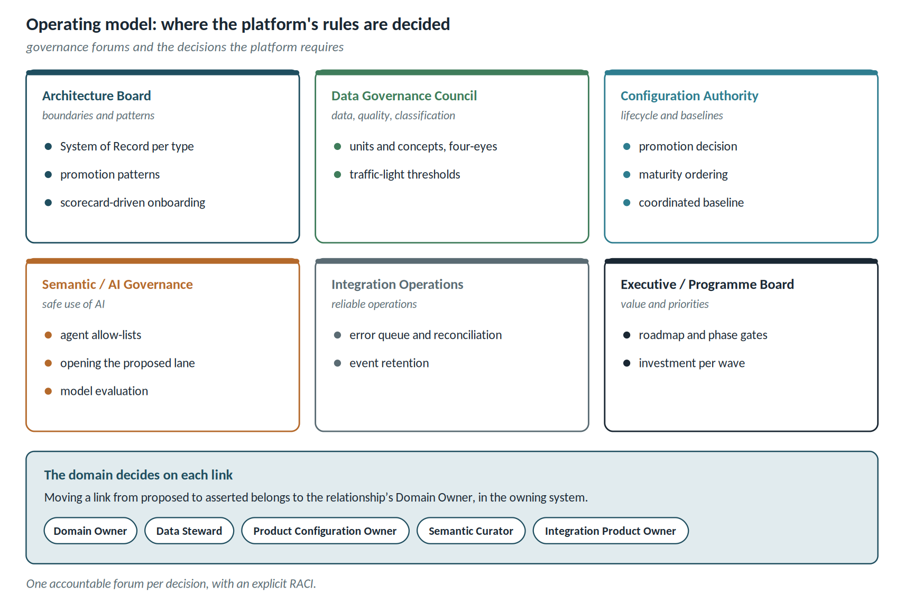

# Operating model

Governance forums change name from one programme to the next, but the decisions to be taken are always the same. The accelerator's governance kit assigns them as follows, and each programme adapts the names:

| Decision required by the platform | Accountable | Responsible |
| ---------------------------------- | -------------------------- | ---------------------------------- |
| Term-to-concept and unit mapping (CR-21) | data governance | semantic curator and data steward, four-eyes |
| Ordering of the maturity scale (FR-S03) | configuration authority | product configuration owner |
| Cockpit traffic-light thresholds (UI-K20) | data governance | use-case owner |
| Moving a link from *proposed* to *asserted* | domain owner of the relationship | engineer of the owning domain |
| Agent tool allow-lists (FR-AG04) | semantic and AI governance | integration product owner |
| Onboarding a tool | architecture board | integration product owner, with the onboarding scorecard |

The cockpit computes the programme KPIs — mandatory link coverage, broken or stale links, first-pass validation, cycle time, impact-package lead time — with formula, source and owner declared (FR-G12).
