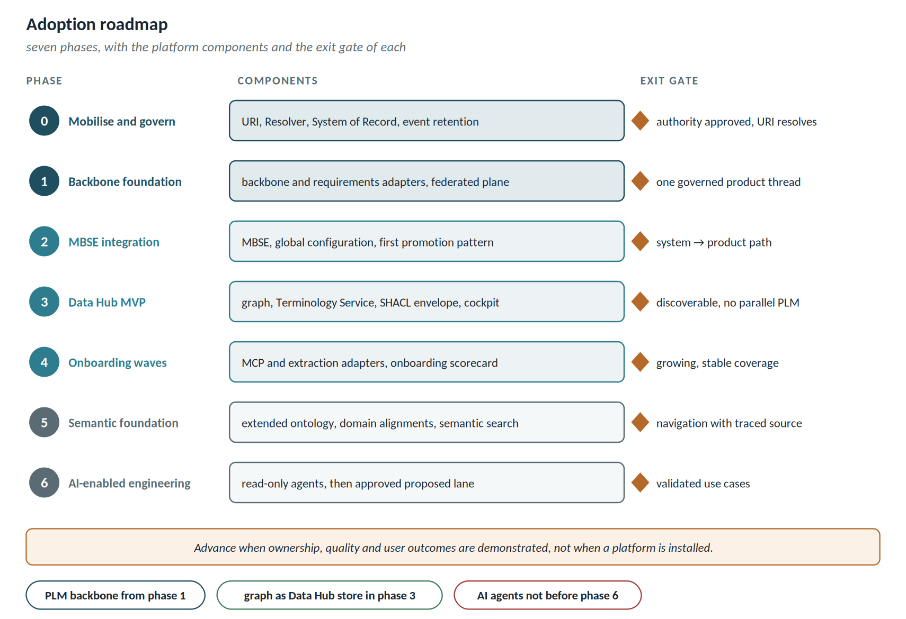

# Adoption roadmap

Seven phases, which each programme goes through with the support of the delivery team. The rule is that each phase must deliver usable value on its own: if phase 2 is cancelled, phase 1 must stay in production.

| Phase | Phase objective | Components | Verifiable outcome |
| ---------------------- | ------------------------------ | -------------------------------------------- | -------------------------------- |
| 0 — Mobilise and govern | charter, architecture authority, ownership, security | URI strategy, Resolver, System of Record per type, JSON-LD / GraphQL / CloudEvents, event retention | authority decisions approved; a hand-created URI resolves |
| 1 — Backbone foundation | product model in the PLM backbone, lifecycle, Change, baselines, core requirement links | backbone and requirements adapters, federated plane, delegated dialog, Link Index | one governed product thread with reliable identity |
| 2 — MBSE integration | requirement → function → logical → physical allocations, coordinated baselines | MBSE adapter, OSLC global configuration, first promotion pattern | traceable system-to-product path on the pilot |
| 3 — Data hub MVP | catalogue, provenance, APIs, first publication pattern | event bus, graph, Terminology Service, SHACL envelope, cockpit and KPIs | discoverable cross-domain results, no parallel PLM |
| 4 — Onboarding waves | prioritised connectors, integration factory | MCP-backed and extraction-backed adapters, onboarding scorecard | growing coverage with stable operations |
| 5 — Semantic foundation | vocabulary, mappings, knowledge graph, semantic search | extended ontology, domain alignments (ISO 15926, ECSS, CFIHOS), semantic search | cross-domain navigation with traced sources |
| 6 — AI-enabled engineering | source-grounded assistants, assisted impact analysis, reuse | read-only agents and MCP server, then the *proposed* lane with approval | validated productivity use cases |

**Phase 0 is the most important and the easiest to skip.** If the identity strategy is decided during phase 1, under delivery pressure, it will be wrong and will cost a migration.

Pilot exit criteria (end of phase 1):

- At least 200 real links created by actual users, not by the project team.
- Zero links lost or corrupted after an upgrade of either tool.
- Mean time to create a link lower than the previous manual method.
- At least three users spontaneously asking to extend to a third tool.

The last criterion is the one that matters. If nobody asks, the platform is solving a problem engineers do not have.
