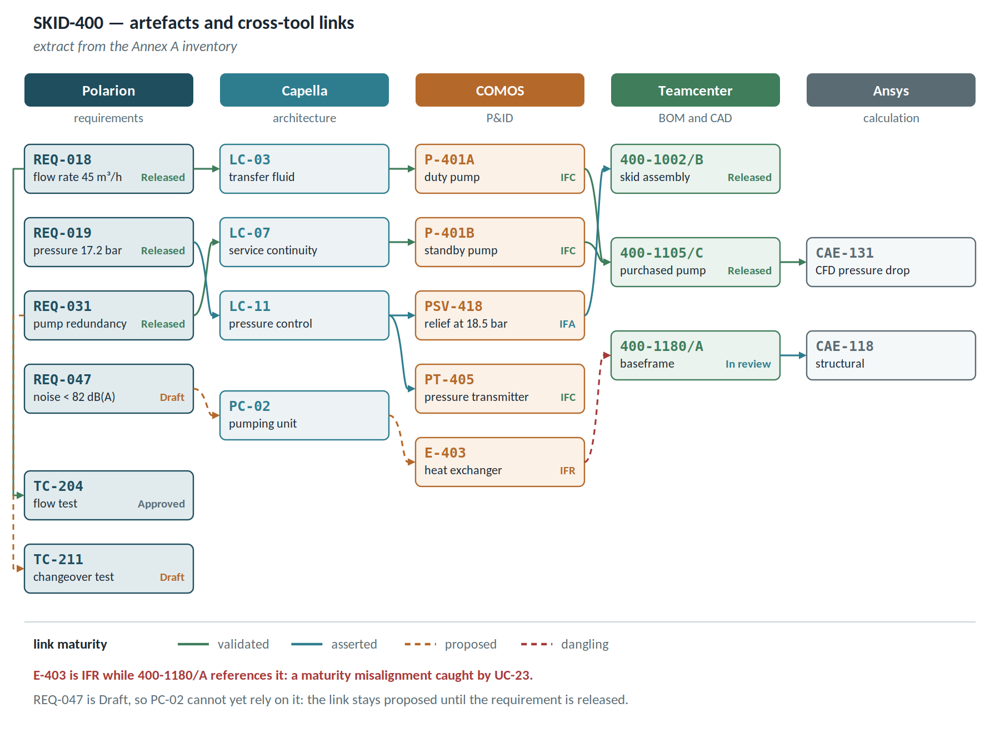

# Annex A — Reference scenario

Every example in this document uses a single scenario, so that artefacts refer to each other rather than being isolated inventions.

**SKID-400** is a fluid transfer pumping module: two centrifugal pumps in duty/standby redundancy, a conditioning heat exchanger, and a control panel. It is small enough to fit on one page and complete enough to touch requirements, architecture, plant, mechanics, calculation and test.

## Tool landscape

| Tool | Role | URI namespace | Adapter |
| ------------------ | ------------------------------ | ---------------------- | -------------------- |
| Polarion | requirements and test cases | `/r/pol/` | pass-through |
| Capella | system architecture | `/r/cap/` | API-backed (EMF) |
| COMOS | P&ID and plant tags | `/r/com/` | API-backed (DEXPI export) |
| Teamcenter | BOM, CAD, documents | `/r/tc/` | API-backed (SOA) |
| Ansys | calculation cases | `/r/cae/` | extraction-backed |

URIs are opaque: `https://plm.example.com/r/pol/9f2c4a1e`. The native identifiers shown below are **attributes**, not identity, and the Resolver holds the map between the two.

## Artefact inventory

| Native ID | Tool | Type | Description | State | Link maturity |
| -------------- | ------------ | -------------- | ------------------------------ | ------------ | -------------- |
| REQ-018 | Polarion | requirement | nominal flow 45 m³/h ±5% | Released | validated |
| REQ-019 | Polarion | requirement | max operating pressure 17.2 bar | Released | validated |
| REQ-024 | Polarion | requirement | fluid temperature 5-95 °C | Released | asserted |
| REQ-031 | Polarion | requirement | redundancy: one standby pump | Released | validated |
| REQ-047 | Polarion | requirement | noise < 82 dB(A) at 1 m | Draft | proposed |
| REQ-052 | Polarion | requirement | standby pump start within 8 s | In review | asserted |
| REQ-061 | Polarion | requirement | wetted material AISI 316L | Released | validated |
| LC-03 | Capella | logical component | Transfer fluid | — | validated |
| LC-07 | Capella | logical component | Ensure service continuity | — | asserted |
| LC-11 | Capella | logical component | Control discharge pressure | — | asserted |
| PC-02 | Capella | physical component | Pumping unit | — | validated |
| PC-05 | Capella | physical component | Control system | — | asserted |
| P-401A | COMOS | equipment | duty centrifugal pump | IFC | validated |
| P-401B | COMOS | equipment | standby centrifugal pump | IFC | validated |
| V-412 | COMOS | valve | check valve on common discharge | IFC | asserted |
| PSV-418 | COMOS | valve | relief valve, set at 18.5 bar | IFA | asserted |
| PT-405 | COMOS | instrument | discharge pressure transmitter | IFC | asserted |
| E-403 | COMOS | equipment | conditioning heat exchanger | IFR | proposed |
| 400-1002/B | Teamcenter | assembly | complete skid | Released | validated |
| 400-1105/C | Teamcenter | component | centrifugal pump, purchased | Released | validated |
| 400-1180/A | Teamcenter | component | welded baseframe | In review | asserted |
| 400-1240/B | Teamcenter | component | electrical panel | Released | asserted |
| CAE-118 | Ansys | calculation case | baseframe structural analysis | complete | asserted |
| CAE-131 | Ansys | calculation case | CFD manifold pressure drop | complete | validated |
| TC-204 | Polarion | test case | flow test | Approved | validated |
| TC-211 | Polarion | test case | standby pump changeover | Draft | proposed |
| TC-219 | Polarion | test case | tightness at 1.5 × PN | Approved | asserted |

The inventory lists the representative artefacts used in the examples. The full project holds about 1,200 artefacts and 3,400 links: the totals quoted in aggregate examples — links to validate, the composition of a tool pair, superseded links — refer to the full project.

## Configurations

| Global configuration | Content | State |
| ------------------------ | ---------------------------------------- | -------------- |
| GC-2026-Q2 | design baseline frozen on 14 April | baseline |
| GC-2026-Q3 | current working stream | stream |
| GC-FAT | baseline for the factory acceptance test | baseline |

## Conventions used in the examples

Each example is written as **situation → system behaviour → outcome**. Where the behaviour depends on a requirement, that requirement is cited in brackets. Numeric values are plausible but invented: they exist to make the behaviour concrete, not to specify a product.
