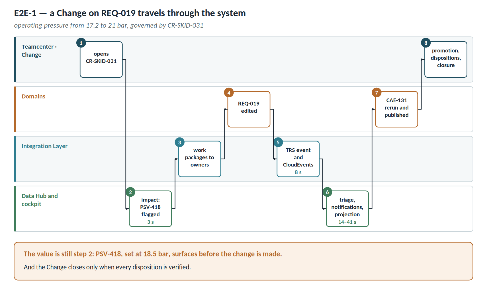

# Annex C — End-to-end walkthroughs

The examples in Annex B show single behaviours. These four walkthroughs chain them together: this is what actually happens in a project week.

## E2E-1 · A requirement change travels through the system

**Trigger.** The customer asks to raise operating pressure from 17.2 to 21 bar. REQ-019 is Released in GC-2026-Q3, so the change goes through a Change in Teamcenter.

| # | Who | What happens | UC | Time |
| ---- | ------------------ | ------------------------------------------------------ | -------- | -------- |
| 1 | Product Configuration Owner | Opens Change CR-SKID-031 on REQ-019 in Teamcenter | FR-G08 | — |
| 2 | Platform | Federated impact assessment: 14 downstream artefacts; PSV-418 flagged because its 18.5 bar setting is below the new value | UC-02 | 3 s |
| 3 | Orchestrator | Distributes work packages to the owners in Polarion, Capella, COMOS and Ansys | FR-G08 | — |
| 4 | Requirements engineer | Edits REQ-019 in Polarion, inside the work package | — | — |
| 5 | Polarion adapter and bus | TRS event and CloudEvents pinned to the new version | FR-G10 | 8 s |
| 6 | Triage | Classifies the change as significant and notifies owners with the 17.2 → 21 bar delta | UC-20, UC-08 | 14 s |
| 7 | Graph | Projects the new version; links from REQ-019 become *superseded* | UC-05 | 41 s |
| 8 | CAE analyst | Reruns CAE-131 and publishes the result with a valid envelope | FR-G04 | — |
| 9 | Configuration Authority | Decides to promote the new result as evidence | FR-G05 | — |
| 10 | PLM backbone | Verifies dispositions, sets the new baseline and closes the Change | FR-G08 | — |
| 11 | Quality lead | The cockpit confirms: no open misalignment on PSV-418 | UC-23 | — |

**What it demonstrates.** Nobody updated a matrix by hand, and the Change closes only when every disposition is verified. The thing that matters — an undersized relief valve — surfaced at step 2, **before** the change was made.

## E2E-2 · A release gate that does not pass

**Trigger.** Gate meeting to freeze GC-FAT ahead of the factory acceptance test.

| # | Who | What happens | UC |
| ---- | ------------------ | -------------------------------------------------------------- | -------- |
| 1 | Project manager | Sets the cockpit to *as of* GC-FAT, provenance "AI excluded" | UC-25 |
| 2 | Platform | Maturity: 38% validated against a 70% threshold | UC-24 |
| 3 | Project manager | Opens the percentage: 61 links to raise to *validated* | UC-24 |
| 4 | Platform | Requirements-to-test coverage: 71% (5 of 7); REQ-047 and REQ-061 uncovered | UC-03 |
| 5 | Quality lead | TC-211 is Draft: it cannot support coverage of REQ-031 | UC-23 |
| 6 | Platform | 12 misalignments, 9 of them from a single COMOS revision | UC-23 |
| 7 | Team | The gate does not pass. Action: close TC-211 and review the COMOS revision | — |
| 8 | Project manager | Exports the snapshot with scope, instant and queries | UC-25 |

**What it demonstrates.** The gate becomes a reading of openable numbers rather than an argument between opinions. And the snapshot is reproducible: six months later it will be possible to show **why** it did not pass.

## E2E-3 · Onboarding a new tool

**Trigger.** A document management system with a REST API enters scope.

| # | Who | What happens | UC | Day |
| ---- | ------------------ | ------------------------------------------------------ | -------- | -------- |
| 1 | Integrator | Hands the OpenAPI specification to the generation assistant | UC-19 | 0 |
| 2 | AI | Proposes a domain model, OSLC mapping and shapes from a 200-resource sample | UC-19 | 1 |
| 3 | Integrator | Reviews the mapping: 11 of 14 fields correct, 3 remapped by hand | UC-19 | 3 |
| 4 | Terminology board | Approves 6 new term-to-concept alignments; 1 rejected | UC-17 | 5 |
| 5 | Integrator | Promotes the configuration to sandbox, tests on ten real resources | — | 6 |
| 6 | Platform | Generates contract tests from the shapes | UC-19 | 6 |
| 7 | Integrator | Promotion to production with four-eyes approval | — | 8 |
| 8 | Platform | First full TRS: 3,400 documents projected | — | 9 |
| 9 | Cockpit | The relationship map shows the new tool isolated: no links | UC-26 | 9 |
| 10 | Engineers | Begin linking documents to existing artefacts | UC-01 | 10+ |

**What it demonstrates.** Nine days against a twenty-day target. And step 9 is the one that matters: **a newly connected tool with no links is worth nothing**, and the map makes that visible instead of letting it be mistaken for done.

## E2E-4 · An audit six months later

**Trigger.** The certification body asks for compliance evidence as of 14 April.

| # | Who | What happens | UC |
| ---- | ------------------ | -------------------------------------------------------------- | -------- |
| 1 | Auditor | Requests requirements-to-verification traceability at baseline GC-2026-Q2 | UC-06 |
| 2 | Platform | Reconstructs the state from the append-only events | UC-06 |
| 3 | Platform | REQ-052 shows as In review at that date, not its state today | UC-06 |
| 4 | Quality lead | Generates the compliance dossier on that GC | UC-10 |
| 5 | Platform | Excludes 2 AI-generated *proposed* links and states their number | UC-10 |
| 6 | Auditor | Asks which geometry CAE-118 ran on | UC-09 |
| 7 | Platform | Answers 400-1180/A revision A, with the link *superseded* by revision B | UC-09 |
| 8 | Auditor | Asks for the provenance of a pressure value | UC-18 |
| 9 | Platform | Shows 250 psi native, 17.24 bar normalised, the factor and the approved mapping | UC-18 |
| 10 | Auditor | Verifies that the evidence was never touched by a model | UC-10 |
| 11 | Platform | PROV-O filter: zero AI-originated assertions in the dossier | — |

**What it demonstrates.** Step 11 is the entire reason AI provenance is kept separate and filterable. Without that filter, the answer to the auditor would have been "we believe not".
