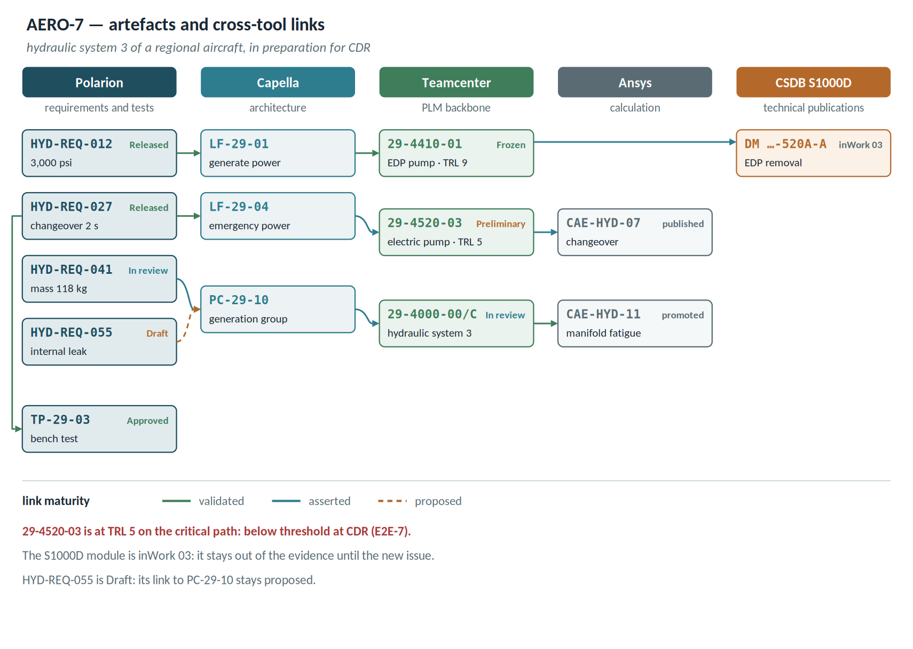
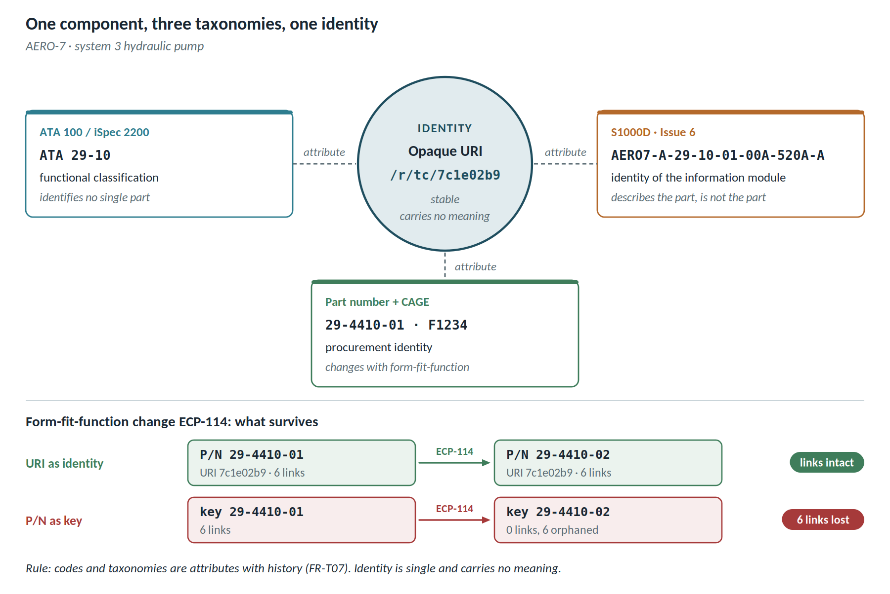
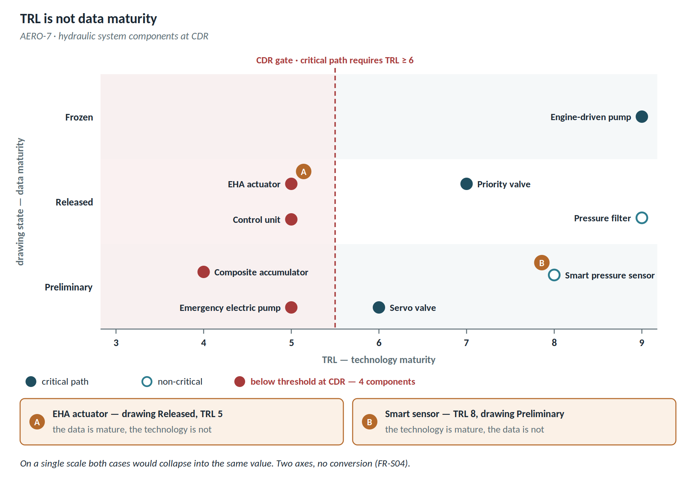

# Annex D — Aerospace scenario AERO-7

**AERO-7** is the second reference scenario: hydraulic system 3 of a regional aircraft, from power generation to actuators. It shows what SKID-400 does not: programme gates, TRL, S1000D information modules, and certification evidence that must hold for years.

## Tools

| Tool | Role | URI namespace | Access |
| ------- | ----------------------------- | --------- | --------------- |
| Polarion | system requirements and test procedures | `/r/pol/` | OSLC pass-through |
| Capella | functional and logical architecture | `/r/cap/` | API-backed |
| Teamcenter | PLM backbone: product, configuration, Change | `/r/tc/` | MCP-backed |
| Ansys | structural and fluid-dynamics calculations | `/r/cae/` | intentional publication |
| CSDB S1000D | technical documentation information modules | `/r/csdb/` | extraction-backed |

## Artefact inventory

| Native ID | Tool | Type | Description | State | TRL |
| --------------- | ----- | --------- | -------------------- | ---------- | --- |
| HYD-REQ-012 | Polarion | requirement | nominal system pressure 3,000 psi | Released | — |
| HYD-REQ-027 | Polarion | requirement | changeover to the electric pump within 2 s | Released | — |
| HYD-REQ-041 | Polarion | requirement | system mass no more than 118 kg | In review | — |
| HYD-REQ-055 | Polarion | requirement | internal leak detection | Draft | — |
| LF-29-01 | Capella | logical function | generate hydraulic power | — | — |
| LF-29-04 | Capella | logical function | ensure emergency power | — | — |
| PC-29-10 | Capella | physical component | main generation group | — | — |
| 29-4000-00/C | Teamcenter | assembly | hydraulic system 3 | In review | — |
| 29-4410-01 | Teamcenter | component | engine-driven pump (EDP) | Frozen | 9 |
| 29-4520-03 | Teamcenter | component | emergency electric pump | Preliminary | 5 |
| 29-4610-02 | Teamcenter | component | EHA actuator | Released | 5 |
| 29-4705-01 | Teamcenter | component | smart pressure sensor | Preliminary | 8 |
| CAE-HYD-07 | Ansys | calculation case | changeover transient | published | — |
| CAE-HYD-11 | Ansys | calculation case | manifold fatigue | promoted | — |
| TP-29-03 | Polarion | test procedure | bench changeover test | Approved | — |
| CALC-HYD-03 | Excel | spreadsheet | system mass budget | published | — |
| SIM-HYD-02 | Simulink | simulation model | electric-pump changeover logic | published | — |
| DMC-AERO7-A-29-10-01-00A-520A-A | CSDB | information module | EDP removal | issue 002, inWork 03 | — |

As for SKID-400, the inventory lists representative artefacts. The pressure of HYD-REQ-012 is a direct example of the quantity dictionary: 3,000 psi native, 206.8 bar normalised, both kept.

## Configurations

| Configuration | Content | State |
| ----------- | ------------------------------------ | ------------ |
| GC-AERO7-PDR | baseline at the preliminary design review | baseline |
| GC-AERO7-CDR | baseline at the critical design review | in preparation |
| GC-AERO7-WIP | current working stream | stream |

## Taxonomies and maturity in AERO-7

### Three taxonomies that coexist and are not interchangeable

| Taxonomy | What it classifies | Example |
| ---------------------- | ---------------------------------- | ------------------------------------ |
| ATA 100 / iSpec 2200 | function on the aircraft | ATA 29 Hydraulic Power, ATA 32 Landing Gear |
| S1000D (Issue 6) | information unit, through the Data Module Code | the DMC identifies the module, not the physical object |
| Part number + CAGE code | procurement identity | 29-4410-01, CAGE F1234 |

**None of the three is the artefact's identity in the platform.** The part number changes at the first form-fit-function modification; the ATA chapter is a functional classification that identifies no single part; the DMC is the identity of a document, not of the component it describes. All three belong in the Terminology Service as taxonomies and attributes, never as a key (FR-T07).

### Four maturity scales that do not overlap

| Native scale | What it measures | Values |
| -------------------------- | ---------------------------------- | -------------------------------- |
| Programme gates | project progress | SRR, PDR, CDR, TRR, QR |
| TRL | maturity of the **technology** | 1-9 |
| MRL | maturity of the **manufacturing process** | 1-10 |
| Drawing state | maturity of the **document** | Preliminary, Released, Frozen |
| S1000D `issueNumber` + `inWork` | maturity of the **information module** | 002-03 = issue 2, third work pass |

**The central trap: TRL is not data maturity.** A component at TRL 8 may still have Preliminary drawings; one at TRL 5 may have a Released drawing for a prototype. Merging them into one canonical scale produces a number that means nothing. This is exactly why FR-S04 keeps fitness for use separate from lifecycle state — and here **two further axes** are needed, TRL and MRL, each with its own ordering and no conversion to the others.

### Examples

| Situation | System behaviour | Outcome |
| ------------------------------ | ---------------------------------------- | ------------------------------ |
| An S1000D data module with `inWork` other than 00 is cited as evidence in a certification dossier | Maturity shape: evidence cannot rest on a module still in work | Excluded from the dossier and declared among the gaps |
| At CDR a component on the critical path is at TRL 5 | Gate rule: at CDR the critical path requires TRL ≥ 6 | Misalignment reported, with the 4 components below threshold listed |
| The part number moves from 29-4410-01 to -02 for a form-fit-function change | URI unchanged, P/N as a historised attribute | Links survive; the part number history stays readable |
| Two suppliers use "Released" with different meanings: internally approved versus customer approved | Cross-tool ordering ambiguous (FR-S03) | Held for the terminology board, not equated automatically |
| A Frozen drawing traces to a requirement still under review | Upstream misalignment (UC-23) | Blocking for the QR gate |

### E2E-5 · Certification evidence frozen at a baseline

**Trigger.** A conformity audit on the hydraulic control software; the authority asks for evidence as of CDR.

| # | Who | What happens | UC |
| ---- | ------------------ | -------------------------------------------------------------- | -------- |
| 1 | Certification lead | Sets the cockpit to the CDR baseline | UC-25 |
| 2 | Platform | Reconstructs the state from events: 3 S1000D modules were `inWork` at that date | UC-06 |
| 3 | Platform | The 3 modules are excluded from the evidence and counted | UC-10 |
| 4 | Auditor | Asks which drawing revision the structural analysis ran on | UC-09 |
| 5 | Platform | Answers with the exact revision and flags that the link is now *superseded* | UC-09 |
| 6 | Auditor | Asks whether the evidence was touched by automated tools | UC-10 |
| 7 | Platform | PROV-O filter: zero AI-originated assertions | — |

**What it demonstrates.** The question at step 2 cannot be answered without historisation. A screenshot taken at CDR proves nothing; replaying the events does.

## E2E-7 · A Change at the critical design review

**Trigger.** While preparing CDR, bench test TP-29-03 shows that changeover to the electric pump takes 2.6 s against the 2 s of HYD-REQ-027. Change CR-AERO7-118 is opened in the PLM backbone.

| # | Who | What happens | Reference |
| --- | ---------- | --------------------------------------------- | --- |
| 1 | Product configuration owner | Opens CR-AERO7-118 on 29-4520-03, the emergency electric pump | FR-G08 |
| 2 | Platform | Federated impact assessment: HYD-REQ-027, LF-29-04, TP-29-03, CAE-HYD-07 and the S1000D maintenance module | UC-02 |
| 3 | Platform | Flags that 29-4520-03 is at TRL 5 on the CDR critical path, below the TRL 6 threshold | UC-23 |
| 4 | Orchestrator | Distributes work packages to requirements, architecture, calculation and technical publications | FR-G08 |
| 5 | CAE analyst | Reruns CAE-HYD-07 with the new changeover logic and publishes it with a valid envelope | FR-G04 |
| 6 | Technical reviewer | Review outcome: promote | FR-G05 |
| 7 | Orchestrator | Promotes the result as a controlled dataset in the PLM backbone, with the identifier returned to the hub | FR-G06 |
| 8 | Platform | The S1000D module is still inWork 03: it stays out of the evidence until the new issue | UC-10 |
| 9 | Configuration manager | Verifies dispositions and sets GC-AERO7-CDR | UC-25 |
| 10 | Cockpit | The CDR gate shows the four critical-path components below TRL 6, each with a maturation plan approved as an accepted risk | UC-24 |

**What it demonstrates.** CDR does not close with a slide that says "all green". It closes with a baseline in which every deviation — an unmet requirement, a TRL below threshold, a module still in work — is visible, traced and decided by someone.

## E2E-8 · A requirement changes before configuration control

**Trigger.** Concept phase, before the GC-AERO7-PDR baseline: no released design exists yet in the PLM backbone. The requirements engineer revises HYD-REQ-027: changeover to the electric pump goes from 3 s to 2 s.

| # | Who | What happens | Reference |
| --- | --- | --- | --- |
| 1 | Requirements engineer | Revises HYD-REQ-027 in Polarion: version 1 to 2, constraint from 3 s to 2 s | — |
| 2 | Adapter and bus | New-version event from the TRS | FR-A03, FR-A12 |
| 3 | Platform | No linked object is under configuration control: the notification and disposition regime applies, not the Change | FR-G17 |
| 4 | Graph | The link from HYD-REQ-027 v1 to LF-29-04 becomes superseded; CAE-HYD-07, published with HYD-REQ-027 v1 in its lineage, becomes superseded input | FR-S13, FR-S14 |
| 5 | Triage | Constraint change, hence significant: notification with the 3 s → 2 s delta to the systems and simulation engineers | UC-20, UC-08, CR-25 |
| 6 | Systems engineer | Disposition: confirmed on the new version; the link is asserted again, then validated | FR-S15 |
| 7 | Simulation engineer | Disposition: to be rerun; reruns CAE-HYD-07 and republishes it with HYD-REQ-027 v2 in its lineage | FR-S15, FR-G04 |
| 8 | Cockpit | No open disposition; the previous result stays accessible but out of the evidence | FR-S16 |

**What it demonstrates.** Without a Change the platform imposes no approval workflow, but it prevents a change from going unnoticed: every downstream item has an owner, a deadline and a recorded decision. When the same system reaches CDR, the regime will be the Change (E2E-7).
