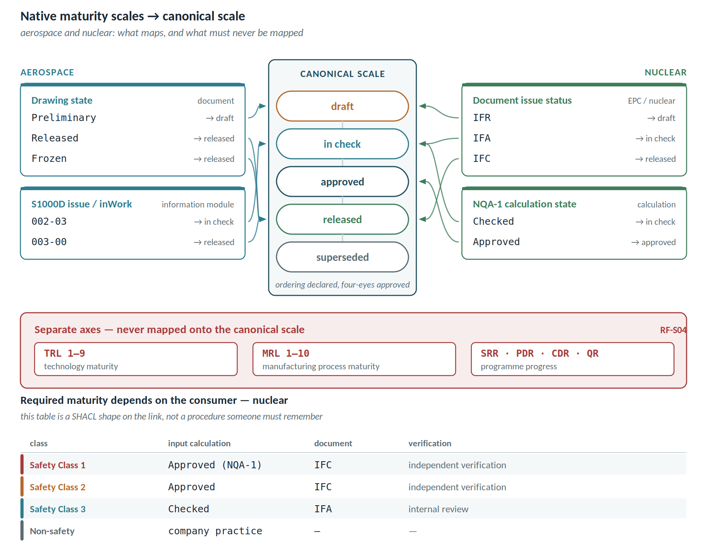
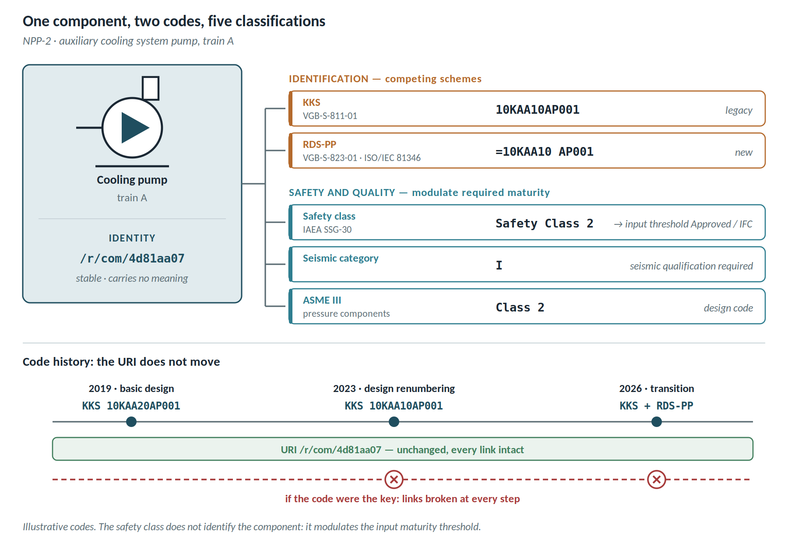
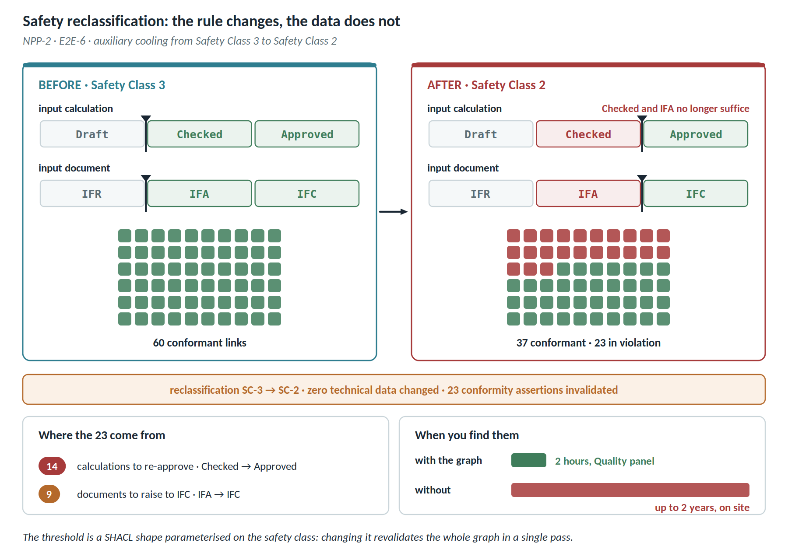

# Annex E — Taxonomy and maturity in nuclear

The second regulated domain shows a case in which the required maturity is not fixed but depends on the safety class of whoever consumes the data. The figure below maps the native scales of both regulated domains onto the canonical scale.

## NPP-2 — auxiliary cooling system

### Identification and safety taxonomies

| Taxonomy | What it classifies | Note |
| ---------------------- | ---------------------------------- | ------------------------------------ |
| KKS (VGB-S-811-01) | systems, equipment, buildings, signals | in use across much of the existing fleet |
| RDS-PP (VGB-S-823-01, on ISO/IEC 81346) | same function, international basis | replacing KKS; vgbe energy maintains both |
| Safety class (IAEA SSG-30) | safety relevance | Safety Class 1, 2, 3, non-safety |
| Seismic category | required resistance | I, II |
| ASME III | code class for pressure components | Class 1, 2, 3 |

**The KKS code is not the identity.** During design, codes are reassigned and renumbered, and a plant in transition carries **two codes for the same object** — the legacy KKS and the new RDS-PP. Treating the code as a key means losing links at every renumbering. Opaque URI, both codes as attributes, each within its own taxonomy.

### Required maturity depends on the consumer's safety class

This is where the **relational maturity** principle becomes literal: there is no absolute level of "sufficient" maturity, only maturity relative to whoever consumes the data.

| Safety class | Minimum required input maturity | Verification |
| -------------------- | ------------------------------------------ | -------------------------- |
| Safety Class 1 | calculation Approved under NQA-1, input document IFC | independent verification mandatory |
| Safety Class 2 | calculation Approved, document IFC | independent verification |
| Safety Class 3 | calculation Checked, document IFA | internal review |
| Non-safety | company practice | — |

This table **is** a SHACL shape: a Safety Class 1 component cannot derive from an unapproved calculation nor from a document still at IFR or IFA. The rule does not live in a procedure someone must remember; it lives in the graph and blocks the link.

### Examples

| Situation | System behaviour | Outcome |
| ------------------------------ | ---------------------------------------- | ------------------------------ |
| A Safety Class 2 pump is sized on a calculation still *Checked* | Shape violated: SC-2 requires *Approved* | Link refused, with the rule cited |
| The input document moves from IFA to IFC | Links that rested on it become *superseded*, not automatically valid | Explicit re-verification required, no silent promotion |
| A technician must work on an SC-1 component | The cockpit declares both maturity **and** freshness of the document | Satisfies document control: only the current approved document at the point of work |
| A change touches an artefact traced to the design basis | Detected through the link in the graph | The change is flagged as subject to formal evaluation |
| A component carries KKS `10KAA10AP001` and RDS-PP `=10KAA10 AP001` | Two attributes, one URI | Queries work with either code |
| An Approved calculation is superseded by an input revision | Link maturity moves to *superseded* (FR-S08) | Appears in the Quality panel before anyone reuses it |

### E2E-6 · A safety reclassification propagates

**Trigger.** A revised safety analysis moves the auxiliary cooling system from Safety Class 3 to Safety Class 2.

| # | Who | What happens | UC |
| ---- | ------------------ | -------------------------------------------------------------- | -------- |
| 1 | Safety engineer | Changes the classification in the system of record | — |
| 2 | Platform | Event propagated; the class is an attribute, not the identity | — |
| 3 | Platform | Revalidates the shapes: the input maturity threshold rises from *Checked/IFA* to *Approved/IFC* | UC-07 |
| 4 | Platform | 23 links that were conformant under SC-3 now violate the rule | UC-23 |
| 5 | Cockpit | The Quality panel shows 23 new violations, all caused by the rule and not by the data | UC-25 |
| 6 | Quality lead | Opens the number: 14 calculations to re-approve, 9 documents to raise to IFC | UC-24 |
| 7 | Project manager | The release gate does not pass until the 23 are closed | UC-24 |

**What it demonstrates.** The reclassification changed not one piece of technical data, yet it invalidated 23 conformity assertions. Without the graph those 23 are discovered one at a time, on site. That is the difference between a problem found in two hours and a problem found in two years.

## What changes relative to SKID-400

| Aspect | SKID-400 | Aerospace | Nuclear |
| ---------------------- | -------------------- | ------------------------------ | ------------------------------ |
| Maturity axes | 4 | 6, with TRL and MRL kept separate | 5, with safety class as a modulator |
| Who sets the threshold | the project | the programme gate | the consumer's safety class |
| Cost of a maturity error | rework | certification non-conformity | safety event and licensing implications |
| Taxonomies in play | 2 | 3, not interchangeable | 5, two of them competing identification schemes |
| Architectural consequence | shapes on links | additional, non-convertible axes | shape parameterised on the class |
